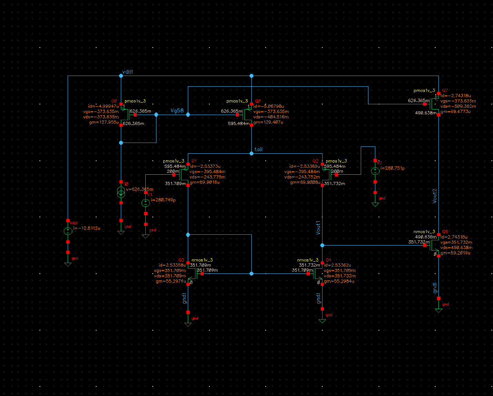
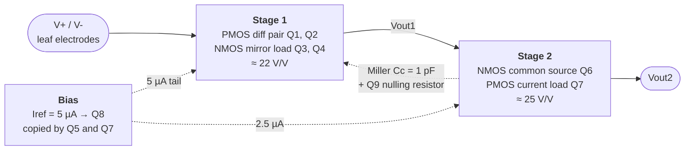
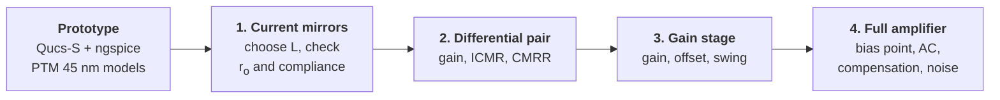
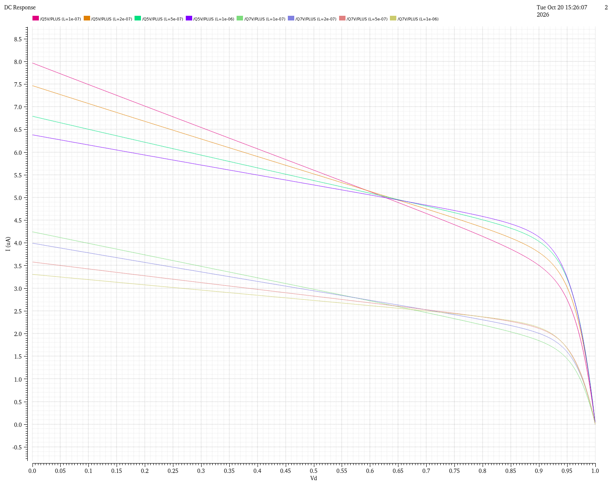
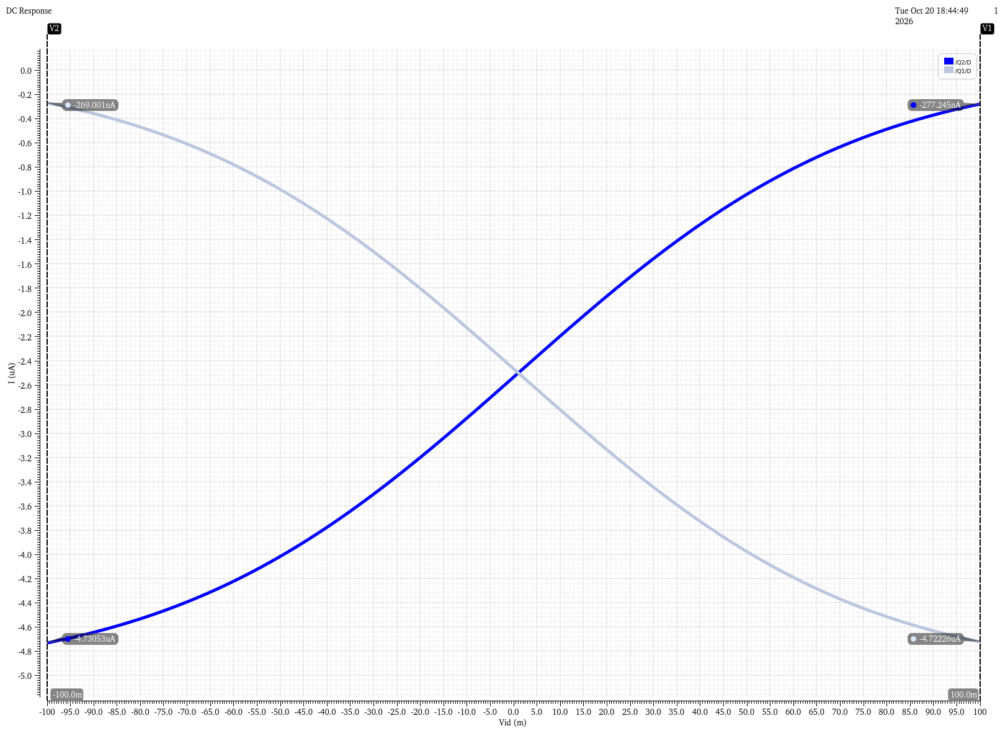
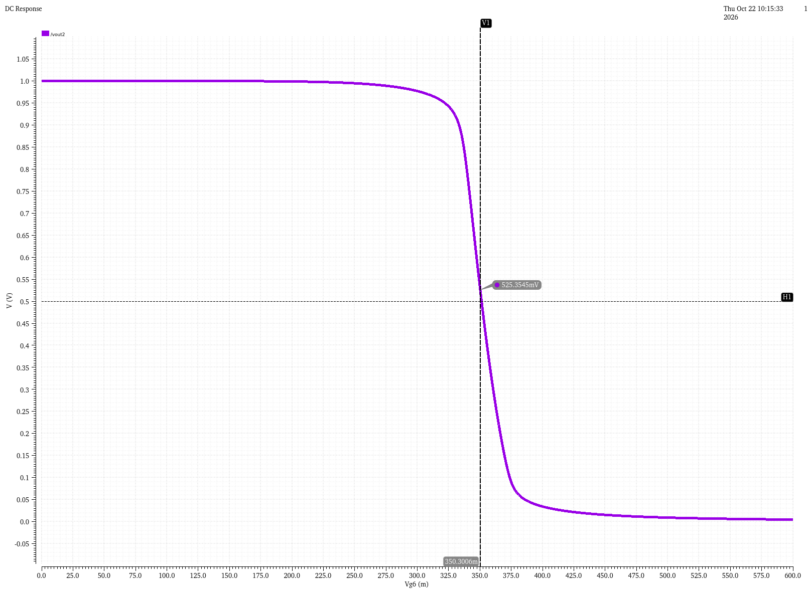
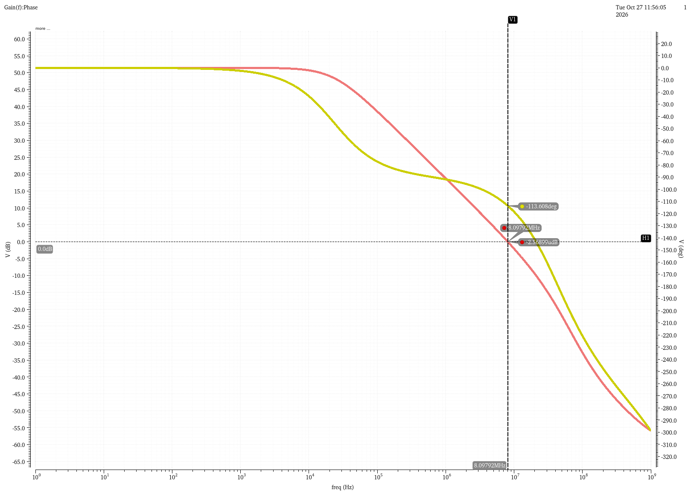
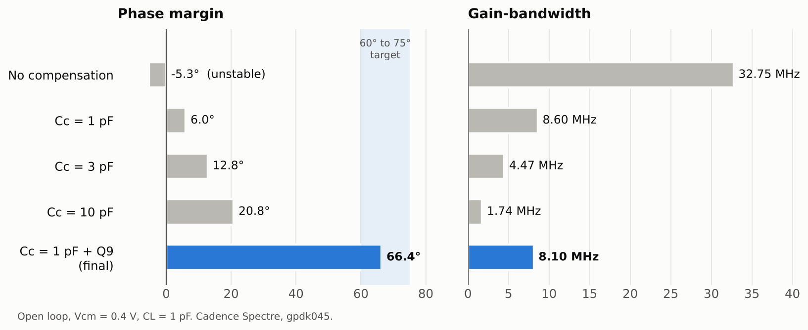

<h1 align="center">Leaf Bioimpedance Op-Amp</h1>

  <b>A 1.0 V, 12.8 µW two-stage CMOS operational amplifier in 45 nm, 
  designed as the analog front-end core of a plant-leaf impedance sensor.</b>

  
  
  
  
  
  

  <a href="#results-at-a-glance">Results</a> ·
  <a href="#why-a-leaf">Application</a> ·
  <a href="#the-circuit">Circuit</a> ·
  <a href="#design-flow">Design flow</a> ·
  <a href="#stage-by-stage">Stage by stage</a> ·
  <a href="#compensation">Compensation</a> ·
  <a href="#limitations-and-future-work">Limitations</a>

---

## Results at a glance

Every number below comes from a Cadence Spectre simulation (marker, operating-point print or ADE expression). Values marked *estimate* are read from a plot axis or calculated.

| Spec | Result | Condition |
|---|---|---|
| Supply | **1.0 V** | single supply |
| Power | **12.81 µW** (12.81 µA) | full amp, $V_{cm}$ = 0.2 V |
| DC open-loop gain | **51.45 dB** (374 V/V) | application point, $V_{cm}$ = 0.4 V |
| Gain-bandwidth (GBW) | **8.10 MHz** | $C_c$ = 1 pF + nulling resistor, $C_L$ = 1 pF |
| Phase margin | **66.4°** | same |
| CMRR | **62.0 dB**, flat from 10 Hz to 100 kHz | |
| Output swing | **250 mV to 851 mV** | range where gain stays within 3 dB of its value at $V_{id}$ = 0 |
| Input-referred noise | **16.0 µV rms** (100 Hz to 100 kHz) | unity-gain buffer |
| Buffer error at 100 kHz | **0.27 %** magnitude, **0.66°** phase | calculated from open-loop gain and phase |
| Systematic offset | **+17.7 µV** | $V_{cm}$ = 0.2 V |
| Input common-mode range | **0.1 V to 0.597 V** | input pair with real tail source |

---

## Why a leaf?

Two electrodes are clipped onto a plant leaf. A small AC signal is applied and the leaf's impedance is measured at many frequencies (**electrical impedance spectroscopy**, EIS). Cell membranes behave like capacitors, so the impedance changes with frequency, and that change tells you about the leaf's **water content and cell health**.

The op-amp is the core of the front-end: it buffers the small voltage picked up by the electrodes. Each spec follows from that job:

| Need | Why | Design answer |
|---|---|---|
| **Low supply, low power** | The sensor sits on a plant for weeks, on a battery or energy harvester | 1.0 V supply, 12.8 µW, devices biased near weak inversion |
| **Bandwidth** | Plant EIS works roughly from 100 Hz to 100 kHz | GBW 8.1 MHz, about 80x above the top of the band |
| **Phase accuracy** | EIS needs both the size and the **phase** of the impedance | under 1° phase error up to 100 kHz |
| **CMRR** | Both electrodes pick up the same mains hum and drift | 62 dB, flat across the band |
| **Low noise** | Sets the smallest impedance change that can be seen | 16 µV rms, SNR about 73 dB for a ±100 mV signal |
| **Input range** | The ±100 mV signal must stay where the amp is accurate | electrodes biased at **0.4 V**, signal moves from 0.3 to 0.5 V |

---

## The circuit

A classic **two-stage Miller op-amp** with a PMOS input pair, built from the transistor names Q1 to Q9.

  
   Full amplifier in Cadence Virtuoso, with the DC operating point annotated.

| Device | Type | Role | W / L |
|---|---|---|---|
| Q8 | PMOS | Bias reference, diode-connected, carries $I_{ref}$ = 5 µA | 20 µm / 1 µm |
| Q5 | PMOS | Tail current source for the input pair (5 µA) | 20 µm / 1 µm |
| Q1, Q2 | PMOS | Differential input pair (Q1 = V-, Q2 = V+) | 20 µm / 1 µm |
| Q3, Q4 | NMOS | Current-mirror active load, differential to single-ended | 10 µm / 1 µm |
| Q6 | NMOS | Second-stage common-source amplifier | 10 µm / 1 µm |
| Q7 | PMOS | Second-stage current-source load (2.5 µA) | 10 µm / 1 µm |
| Q9 | NMOS | Nulling resistor in deep triode, $R_{on}$ = 26.1 kΩ | 2 µm / 4 µm |
| $C_c$ | cap | Miller compensation, Vout1 → Q9 → Vout2 | 1 pF |
| $C_L$ | cap | Load | 1 pF |

All transistors use a 2 µm unit finger, so every mirror ratio is set exactly by the finger count. **L = 1 µm everywhere** (except Q9): it raised the output resistance, and the total noise came out at about half that of the 100 nm prototype.

---

## Design flow

Each block was first simulated **on its own** (ideal sources standing in for the rest of the circuit), then everything was assembled and re-checked. Numbers from the single blocks predicted the full amplifier to within 0.3 dB.

The design was prototyped in Qucs-S with PTM 45 nm models, then moved to the Cadence gpdk045 kit. gpdk045 shows much stronger short-channel effects, so channel lengths went from 100 nm to 1 µm, and the nulling-resistor size had to be redone.

---

## Stage by stage

<table>
<tr>
<td width="50%" valign="top">

### [1. Current mirrors →](docs/01-current-mirrors.md)

PMOS bias mirror (Q8, Q5, Q7) and NMOS load mirror (Q3, Q4).

- L swept from 100 nm to 1 µm: $r_o$ of the tail source **210 → 452 kΩ**
- Each source needs only **about 60 mV** to stay saturated
- Longer L cost **no voltage headroom**

</td>
<td width="50%" valign="top">

### [2. Differential pair →](docs/02-differential-pair.md)

PMOS input pair with NMOS mirror load.

- Gain **22.1 V/V (26.9 dB)**, hand calculation within 1 %
- ICMR **0.1 V to 0.597 V**
- DC CMRR **62.0 dB**

</td>
</tr>
<tr>
<td width="50%" valign="top">

### [3. Gain stage →](docs/03-gain-stage.md)

NMOS common source with PMOS current-source load.

- Gain **24.56 V/V (27.8 dB)**, hand calculation within 0.1 %
- Output swing **243 mV to 855 mV**
- Systematic offset **1.04 mV** at the gate of Q6

</td>
<td width="50%" valign="top">

### [4. Full amplifier →](docs/04-full-amplifier.md)

All blocks assembled, compensated and characterised.

- **66.4° PM at 8.10 MHz GBW**
- 62.0 dB CMRR, 16.0 µV rms noise
- Electrode bias chosen from a buffer sweep: **0.4 V**

</td>
</tr>
</table>

---

## Compensation

Without compensation, the two high-impedance nodes (Vout1 and Vout2) give two poles close together, and the amplifier would **oscillate** as a buffer (phase margin -5.3°).

<picture>
  <source media="(prefers-color-scheme: dark)" srcset="figures/04-full-amplifier/compensation-summary-dark.png">
  
</picture>

- **Miller capacitor alone** splits the poles, but it also opens a path that skips Q6 and creates a **right-half-plane zero**. Even 10 pF only reaches 20.8°, at a fraction of the speed.
- **Adding Q9** (an NMOS in deep triode, 26.1 kΩ) in series with $C_c$ moves that zero to the left half plane. Phase margin jumps to **66.4°** while GBW drops only 6 %.

Full explanation with Bode plots: [docs/04-full-amplifier.md](docs/04-full-amplifier.md#6-frequency-response-and-compensation).

---

## Limitations and future work

- **Modest DC gain (51.5 dB).** Enough here: accuracy in the leaf band is limited by GBW, not DC gain, and the constant static error is removed by calibration against a reference resistor. Longer channels would add gain, at the cost of area and speed.
- **No cascodes.** With a 1.0 V supply there is not enough headroom to stack another device.
- **Single-ended output.** A fully differential version would improve CMRR further.
- **Not simulated (by choice):** small-step transient (66.4° PM already implies a well-damped response), slew rate (the application needs only about 0.063 V/µs, *estimate*), PSRR, corners and Monte Carlo.
- **Schematic level only.** No layout or post-layout extraction.

---

## Repository layout

| Path | Contents |
|---|---|
| [`docs/01-current-mirrors.md`](docs/01-current-mirrors.md) | Bias and load mirrors: L sweep, output resistance, compliance |
| [`docs/02-differential-pair.md`](docs/02-differential-pair.md) | Input pair: current steering, gain, ICMR, CMRR |
| [`docs/03-gain-stage.md`](docs/03-gain-stage.md) | Second stage: gain, offset, output swing |
| [`docs/04-full-amplifier.md`](docs/04-full-amplifier.md) | Assembly: bias point, AC, compensation, CMRR, swing, noise |
| [`docs/cadence-ade-notes.md`](docs/cadence-ade-notes.md) | Practical Cadence ADE Explorer tips learned along the way |
| [`figures/`](figures) | All simulation plots and schematics, one folder per stage |

## Tools

| Tool | Version |
|---|---|
| Cadence Virtuoso | IC6.1.8, ADE Explorer |
| Simulator | Spectre 23.1 |
| Process kit | gpdk045 v6.0 (Cadence generic 45 nm), `pmos1v` / `nmos1v` standard-Vt devices |
| Prototype | Qucs-S with ngspice and PTM 45 nm BSIM4 models |

---

  Microelectronics course project, Junia ISEN (Lille), 2026 
  <b>Saleh Al Homeidy</b> · <a href="https://github.com/salehali22">@salehali22</a>

