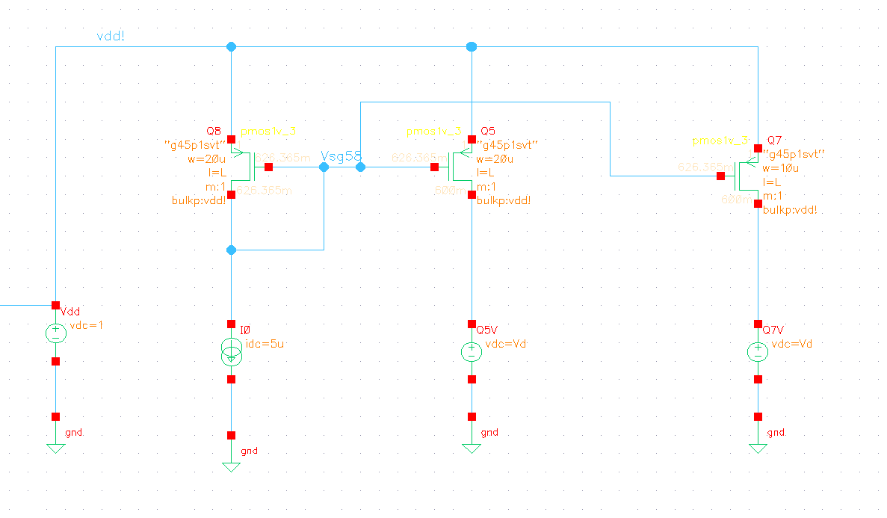
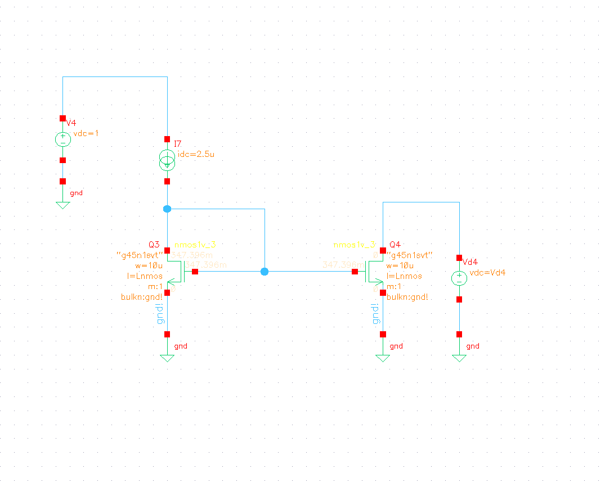
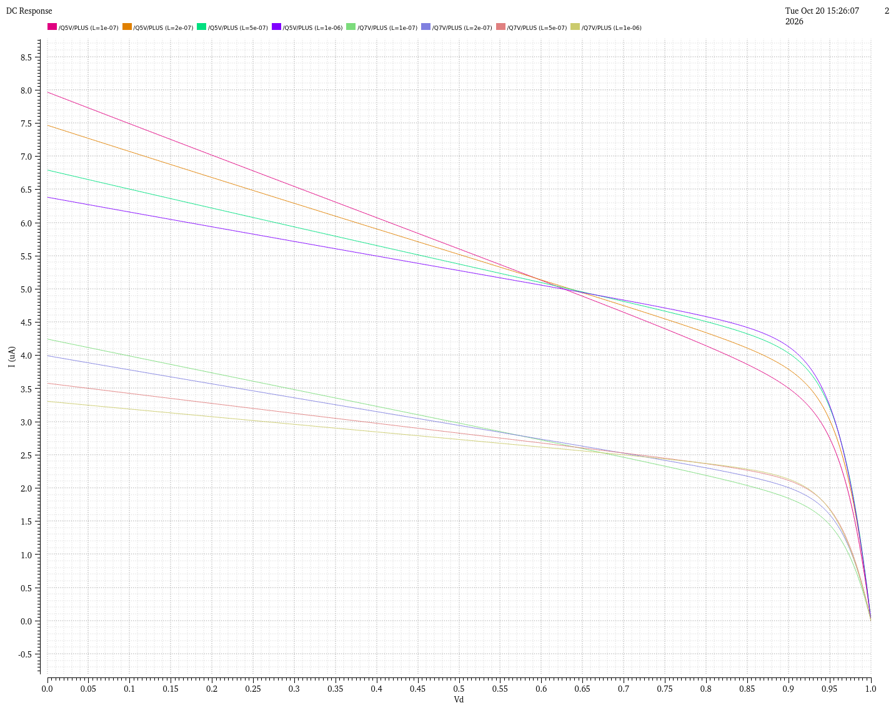
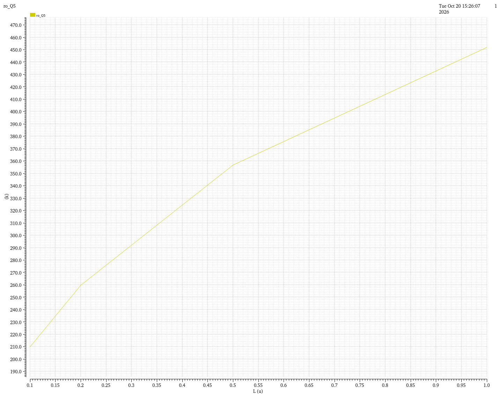
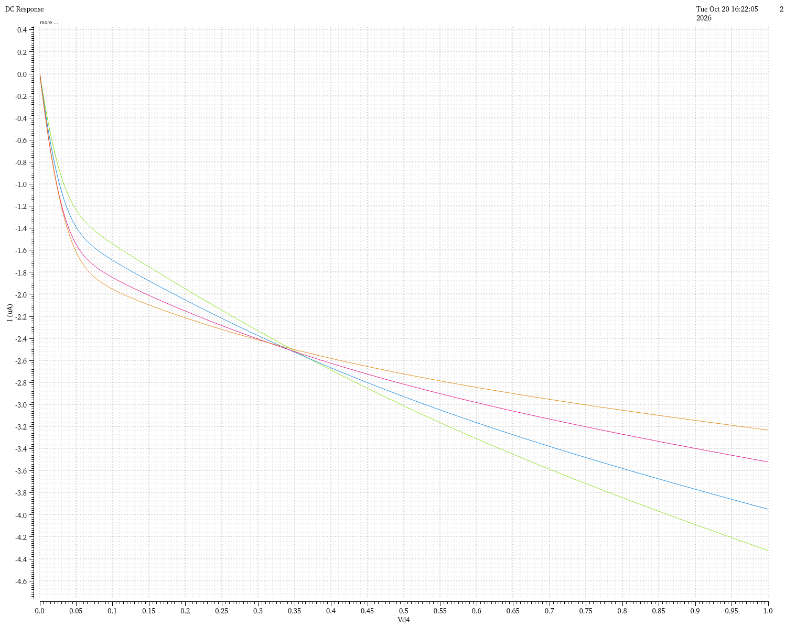
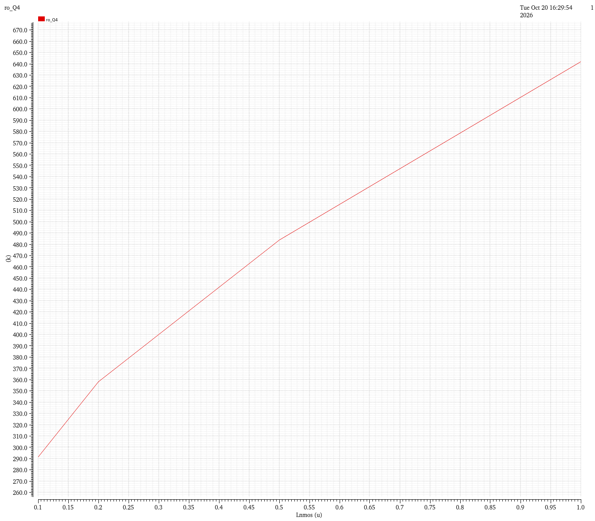

[← Overview](../README.md) · **1. Current mirrors** · [2. Differential pair →](02-differential-pair.md)

# 1. Current mirrors and sources

> **In one line:** a 5 µA reference is copied into the tail current (5 µA) and the second-stage current (2.5 µA), and an NMOS mirror acts as the input pair's active load. Choosing **L = 1 µm** doubled the output resistance at no headroom cost.

| Result | Value |
|---|---|
| Mirror ratio (PMOS) | 1 : 1 : 0.5 (Q8 : Q5 : Q7) |
| Mirror ratio (NMOS) | 1 : 1 (Q3 : Q4) |
| Chosen L | 1 µm for all mirror devices |
| $r_o$, 100 nm → 1 µm | PMOS 210 → 452 kΩ, NMOS about 294 → 599 kΩ |
| Compliance | PMOS source up to 0.937 V, NMOS sink down to 60.8 mV |

---

## 1.1 What the block does

- **Q8 is the reference.** 5 µA flows through it. Its gate is tied to its drain, so it sets its own gate voltage to whatever carries exactly 5 µA.
- **Q5 and Q7 share that gate voltage**, so they copy the current, scaled by width:
  - Q5 (same size as Q8) gives **5 µA**, the tail current of the input pair.
  - Q7 (half the width) gives **2.5 µA**, the current of the second stage.
- **Q3 / Q4** is a second mirror, NMOS, at the bottom. In the amplifier it is the **active load** of the input pair: Q3 takes one branch's current and Q4 copies it to the other side.

A mirror copies a **voltage** (the shared gate). The same voltage on an identical transistor gives the same current, and no current flows into a gate.

A good current source:
1. **copies correctly** (right ratio),
2. **stays constant** when the voltage across it changes, measured by the output resistance $r_o$ (high $r_o$ = flat curve),
3. **needs little voltage** to work (compliance). Below about $V_{DSAT}$ across it, the current collapses.

Why $r_o$ matters later: for the tail (Q5), high $r_o$ means better **CMRR**. For the loads (Q4, Q7), the signal current flows through $r_o$, so high $r_o$ means more **gain** ($A = g_m r_o$).

## 1.2 Testbenches

Each mirror output drives an ideal voltage source that is swept from 0 to 1 V. The source fixes the drain voltage and measures the copied current. The reference currents are the real ones in the amplifier (5 µA and 2.5 µA), because $r_o$, $V_{DSAT}$ and $g_m$ all depend on current.

<table>
<tr>
<td></td>
<td></td>
</tr>
<tr>
<td align="center">PMOS mirror: Q8 (reference), Q5 (tail), Q7 (stage 2)</td>
<td align="center">NMOS mirror: Q3 (diode), Q4 (copy)</td>
</tr>
</table>

| Device | Type | Fingers x width | Total W | L |
|---|---|---|---|---|
| Q8, Q5 | pmos1v | 10 x 2 µm | 20 µm | 1 µm |
| Q7 | pmos1v | 5 x 2 µm | 10 µm | 1 µm |
| Q3, Q4 | nmos1v | 5 x 2 µm | 10 µm | 1 µm |

## 1.3 PMOS mirror: current vs drain voltage, and the effect of L

DC sweep of the drain voltage from 0 to 1 V, repeated for L = 100 nm, 200 nm, 500 nm and 1 µm.

  
   Q5 (upper family) and Q7 (lower family) current vs drain voltage, four channel lengths.

What it shows:
1. **The ratio is correct.** Q7 always carries about half of Q5.
2. **All Q5 curves cross at 5 µA near 0.63 V.** That is where Q5's drain sits at the same voltage as Q8's (0.626 V): same voltages on both transistors means a perfect copy.
3. **The current is not flat.** At L = 100 nm, Q5 falls from 8.0 µA to about 3.3 µA across the sweep. This is channel-length modulation and DIBL: the drain voltage reaches into a short channel and changes the current.
4. **Longer L gives a flatter curve.**
5. **The knee stays near 0.92 to 0.94 V for every L.** Above it there is not enough voltage left across Q5.

  
   Output resistance of Q5 at Vd = 0.6 V, extracted as 1 / |dI/dVd|.

| L | $r_o$ (Q5) | Early voltage $V_A = I \cdot r_o$ |
|---|---|---|
| 100 nm | 209.9 kΩ | 1.05 V |
| 200 nm | 259.7 kΩ | 1.30 V |
| 500 nm | 356.8 kΩ | 1.78 V |
| 1 µm | 451.9 kΩ | 2.26 V |

- $r_o$ rises with L but **not in proportion**: 10x longer gives about 2.2x more. In this kit DIBL is only partly reduced by a longer channel.
- **The knee does not move** with L, so the longer device costs **no voltage headroom**, only area and some capacitance.

**Decision: L = 1 µm for Q8, Q5 and Q7.**

## 1.4 NMOS mirror (Q3, Q4)

Same method: sweep Q4's drain from 0 to 1 V for the same four lengths. (Current is plotted negative only because of the source's sign convention.)

<table>
<tr>
<td></td>
<td></td>
</tr>
<tr>
<td align="center">Q4 current vs drain voltage, four lengths</td>
<td align="center">Q4 output resistance vs L</td>
</tr>
</table>

- **All curves cross at 2.5 µA near 0.35 V**, where Q4's drain equals Q3's (0.347 V).
- **Mirror image of the PMOS case:** the knee is at the **bottom** (the current collapses below about 0.05 to 0.1 V).
- $r_o$ grows from about 294 kΩ (100 nm) to about 600 kΩ (1 µm). The operating-point value used in the design is **598.9 kΩ** at 0.35 V.

**Decision: L = 1 µm for Q3 and Q4**, for two reasons:
- **Gain:** stage-1 gain is $g_{m1}(r_{o2} \parallel r_{o4})$, so a larger $r_{o4}$ raises it directly.
- **Noise:** in the prototype, flicker (1/f) noise was about 80 % of the total. Larger gate area means less flicker noise.

## 1.5 Operating point and compliance

From the DC operating-point print, final sizes. Q5 at $V_d$ = 0.6 V, Q4 at $V_d$ = 0.35 V.

| | Q5 (PMOS source) | Q4 (NMOS sink) |
|---|---|---|
| $I_D$ | 5.06 µA | 2.50 µA |
| $V_{TH}$ | -332.6 mV | 390.2 mV |
| $V_{GS}$ | -373.6 mV | 351.2 mV |
| $V_{GS} - V_{TH}$ | -41.0 mV (41 mV past threshold) | -39.0 mV (below threshold) |
| $V_{DSAT}$ | 63.2 mV | 60.8 mV |
| $r_o$ | 451.8 kΩ | 598.9 kΩ |
| $g_m$ | 129.2 µS | 54.7 µS |
| $g_m / I_D$ | about 25.6 V⁻¹ | 21.9 V⁻¹ |
| Self gain $g_m r_o$ | 58.4 | 32.8 |
| Compliance | drain at most **0.937 V** | drain at least **60.8 mV** |

- **Q4 is in weak inversion** ($V_{GS}$ 39 mV below $V_{TH}$, Spectre region 3).
- **Q5 is just above threshold** (moderate inversion). For a PMOS both values are negative, so -41 mV means $|V_{GS}|$ is 41 mV **above** $|V_{TH}|$.
- **Why this matters for 1.0 V:** each source needs only about 60 mV across it, which leaves most of the supply for the signal. The cost is speed (low $f_T$) and mismatch sensitivity, both acceptable below 100 kHz.

Mirror accuracy: Q5 carries 5.06 µA vs Q8's 5.00 µA (+1.2 %, because its $V_{SD}$ is a bit larger). Q7 carries 2.62 µA instead of 2.50 µA (+4.7 %). Its effect on the second stage is checked in [stage 3](03-gain-stage.md).

---

[← Overview](../README.md) · **1. Current mirrors** · [2. Differential pair →](02-differential-pair.md)
