[← 1. Current mirrors](01-current-mirrors.md) · [Overview](../README.md) · **2. Differential pair** · [3. Gain stage →](03-gain-stage.md)

# 2. Differential pair

> **In one line:** two matched PMOS transistors share a 5 µA tail current. A small input difference shifts that current, and the mirror load turns it into a large voltage at `out1`: **22.1 V/V (26.9 dB)**, with an input common-mode range of **0.1 V to 0.597 V** and **62.0 dB** CMRR.

| Result | Value |
|---|---|
| Q1 / Q2 size | 20 µm / 1 µm, $g_m/I_D$ = 27.6 V⁻¹ |
| `out1` at rest | 350.3 mV |
| Differential gain | -22.1 V/V (26.9 dB), predicted 22.4 V/V |
| Weak-inversion slope factor n | about 1.35 (from tanh fit) |
| ICMR (real tail) | 0.1 V to 0.597 V |
| Common-mode gain at $V_{cm}$ = 0.2 V | -35.16 dB |
| DC CMRR | 62.0 dB |

---

## 2.1 What the block does

- Think of it as a **seesaw sharing 5 µA**. Whichever gate is **lower** takes more current (a PMOS turns on harder when its gate goes down). The total is always 5 µA.
- The NMOS mirror Q3/Q4 is the **active load**. Q3 takes Q1's current and Q4 copies it to the right side. At `out1`, Q2's current meets Q4's copy of Q1's current. Any difference has nowhere to go except to move the voltage of `out1`. That is the gain mechanism.

The inputs are written so the two "knobs" are independent:

$$V_2 = V_{cm} + \frac{V_{id}}{2} \qquad V_1 = V_{cm} - \frac{V_{id}}{2}$$

- $V_{id}$ (differential) is the **signal**: the pair should amplify it.
- $V_{cm}$ (common mode) is the **average level**: the pair should ignore it, and keep working over a range of it (the ICMR).

## 2.2 Testbench

The tail is first an **ideal 5 µA source**, so everything measured belongs to the pair and its load only. It is replaced by the real Q8/Q5 bias in section 2.6.

<table>
<tr>
<td>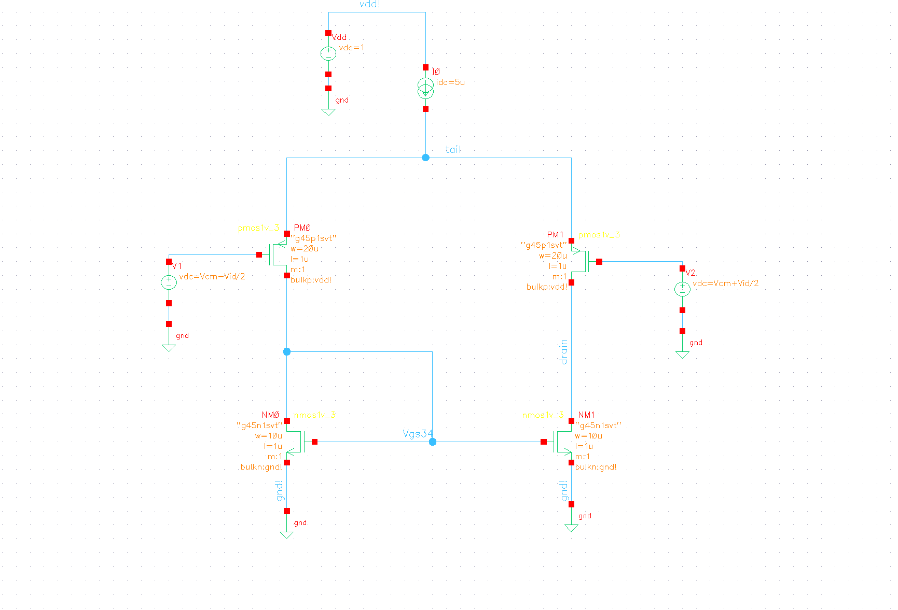</td>
<td>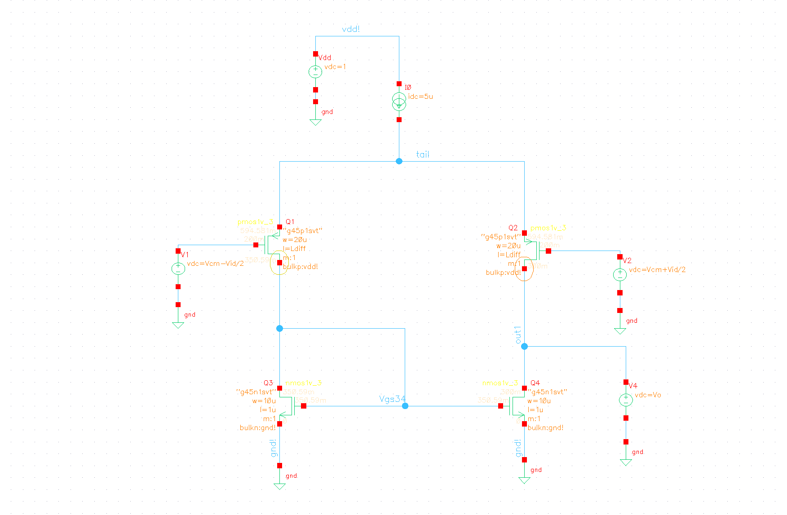</td>
</tr>
<tr>
<td align="center">Pair with ideal 5 µA tail and mirror load</td>
<td align="center">Same, with <code>out1</code> held by a source (current-steering test)</td>
</tr>
</table>

**Why 20 µm / 1 µm** (the prototype used 2 µm / 100 nm):
- At 2.5 µA per device the pair is near weak inversion, where $g_m/I_D$ has a ceiling of about $1/(nV_T)$. A wide device reaches it: measured 27.6 V⁻¹ vs a ceiling of about 28.6 V⁻¹.
- Large gate area means less flicker noise and better matching (lower offset).
- L = 1 µm gives high $r_o$, as in [stage 1](01-current-mirrors.md).

## 2.3 Output vs differential input

DC sweep of $V_{id}$ at $V_{cm}$ = 0.2 V, `out1` left free.

<table>
<tr>
<td>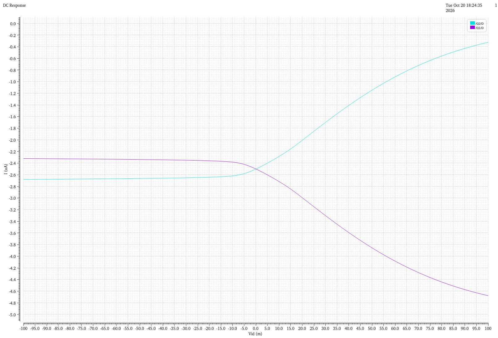</td>
<td>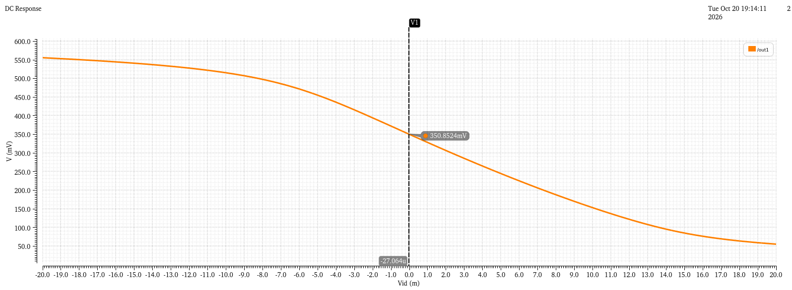</td>
</tr>
<tr>
<td align="center">Branch currents with <code>out1</code> free, ±100 mV</td>
<td align="center"><code>out1</code> vs Vid, ±20 mV, marker at 0</td>
</tr>
</table>

- At $V_{id}$ = 0, **`out1` = 350.3 mV**: the mirror gate voltage, since Q4 then carries the same current as Q3 at the same $V_{GS}$.
- A few mV of $V_{id}$ move `out1` steeply. It **falls** as $V_{id}$ rises (inverting from V+ to `out1`; the second stage inverts again, so V+ is non-inverting overall).
- For large $V_{id}$, `out1` hits a wall on each side (Q2 squeezed near the tail, or Q4 squeezed near ground). With `out1` left free, the branch currents (left plot) can only split on one side, which is why the next test clamps `out1`.

## 2.4 Current steering

`out1` held at its rest value (350.3 mV) by an ideal source, so the currents can split freely.

  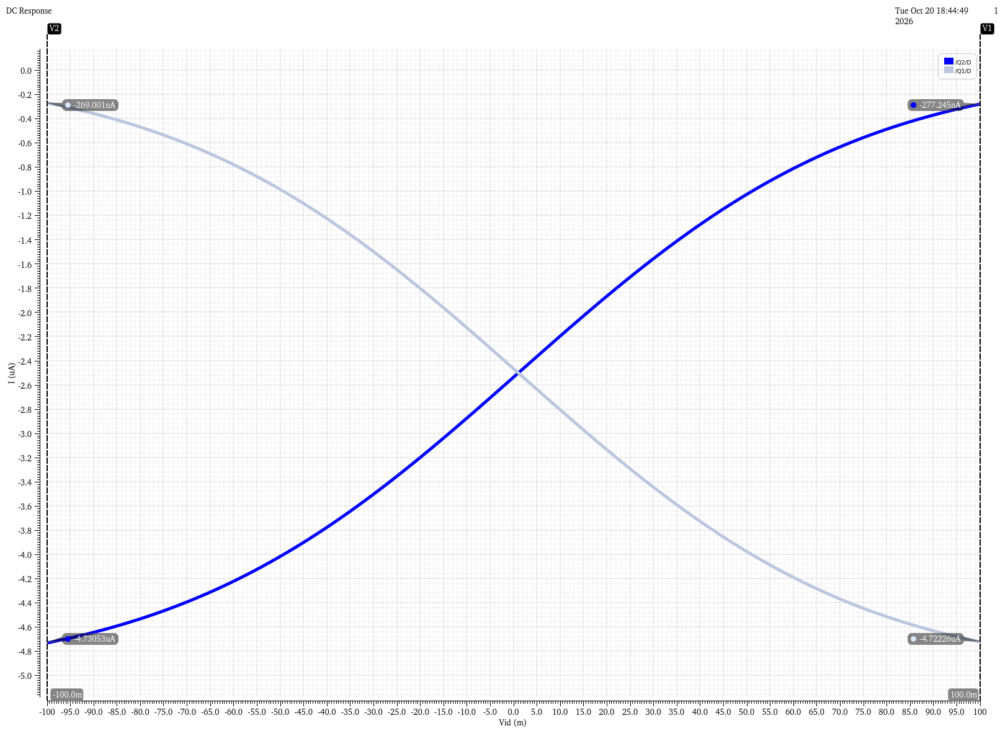
   Q1 and Q2 drain currents vs Vid: the seesaw.

| $V_{id}$ | Q1 | Q2 | Sum |
|---|---|---|---|
| -100 mV | 269.0 nA | 4.731 µA | 5.000 µA |
| 0 | 2.5 µA | 2.5 µA | 5.000 µA |
| +100 mV | 4.722 µA | 277.2 nA | 5.000 µA |

The curves follow the weak-inversion law $\Delta I / I_{tail} = \tanh\!\left(V_{id}/(2nV_T)\right)$. At 100 mV, $\Delta I / I_{tail}$ = 0.892, which gives **n ≈ 1.35**, a typical weak-inversion slope factor. About 100 mV steers 95 % of the current to one side.

## 2.5 Differential gain

**Operating point** at $V_{id}$ = 0:

| | Q2 (input PMOS) | Q4 (load NMOS) |
|---|---|---|
| $I_D$ | 2.500 µA | 2.500 µA |
| $V_{GS} - V_{TH}$ | -16.7 mV | -39.0 mV |
| $V_{DSAT}$ | 58.2 mV | 60.8 mV |
| Room left before leaving saturation | **186.6 mV** | **289.5 mV** |
| $g_m$ | 69.05 µS | 54.67 µS |
| $g_m/I_D$ | 27.6 V⁻¹ | 21.9 V⁻¹ |
| $r_o$ | 705.5 kΩ | 599.5 kΩ |

**Predicted:**

$$A_{dm} = g_{m2}\,(r_{o2} \parallel r_{o4}) = 69.05\ \mu S \times 324\ k\Omega \approx 22.4\ \text{V/V}$$

**Measured** (derivative of `out1` over a ±20 mV sweep):

  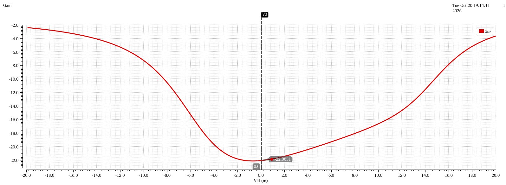
   d(out1)/dVid. Peak -22.14 V/V (26.9 dB).

- **-22.14 V/V = 26.9 dB**, within 1 % of the prediction.
- Full gain holds only over a few mV of $V_{id}$. That is fine: in closed loop, feedback keeps $V_{id}$ ≈ 0.
- The curve is lopsided because Q2 has less room (187 mV) than Q4 (289 mV).

## 2.6 Real tail source and ICMR

With an ideal tail, the tail voltage can rise above the supply (1.30 V at $V_{cm}$ = 1 V), so no upper limit can appear. The ideal source was replaced by Q8/Q5 from [stage 1](01-current-mirrors.md).

<table>
<tr>
<td>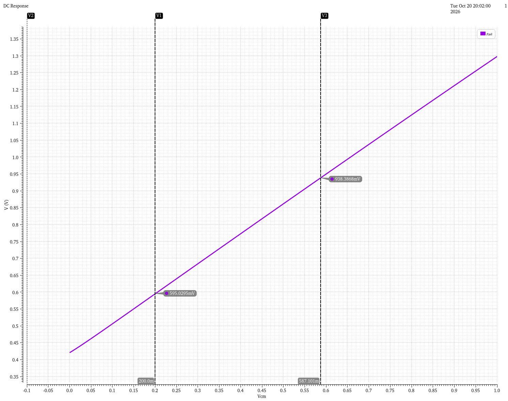</td>
<td>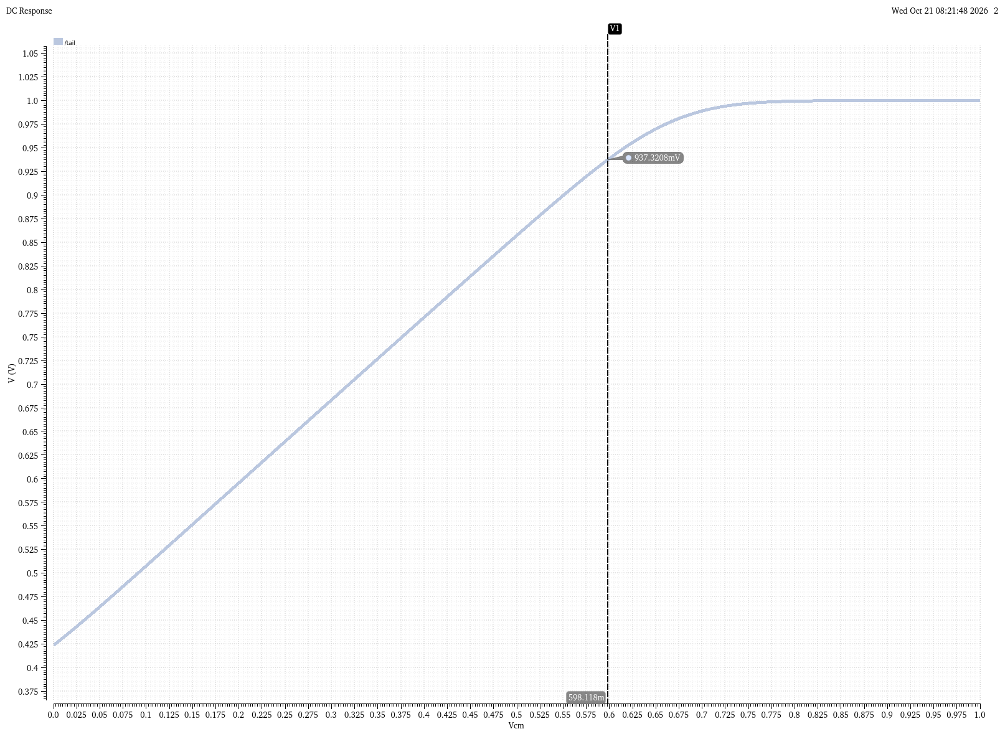</td>
</tr>
<tr>
<td align="center">Ideal tail: the tail climbs past VDD</td>
<td align="center">Real Q5: the tail flattens at 1.0 V</td>
</tr>
</table>

The **ICMR** is the range of $V_{cm}$ over which every transistor keeps working. The two edges come from **two different transistors**, so they need **two different measurements**:

| Edge | Limited by | What happens | How it is measured |
|---|---|---|---|
| **Top** | Q5 (tail source) | The tail follows the input about 0.4 V above it, and Q5 runs out of room under $V_{DD}$ | Tail voltage |
| **Bottom** | Q2 (input device) | The tail drops toward `out1` (≈ 0.35 V), Q2 loses room and its $r_o$ falls | Differential gain |

**Top edge = 0.597 V.** Q5 stays a current source while its room is at least its $V_{DSAT}$ (63.2 mV):

$$V_{tail} \le 1.0 - 0.0632 = 0.937\ \text{V}$$

A marker at a tail voltage of 936.83 mV gives **$V_{cm}$ = 597.4 mV**.

The gain cannot show this edge: near weak inversion $g_m \propto I$ and $r_o \propto 1/I$, so $g_m r_o$ barely changes when the tail current starts to die.

**Bottom edge = 0.1 V.** Here the tail current stays a full 5 µA, so only the gain reveals the problem. Method:
1. Sweep $V_{id}$ for $V_{cm}$ = 0, 0.1 ... 0.8 V.
2. Read each curve **at $V_{id}$ = 0** (where feedback holds the real amplifier).
3. Reference: mid-range gain, 27.4 dB at $V_{cm}$ = 0.4 V. Allowed drop: 3 dB, so the limit is 24.4 dB.

  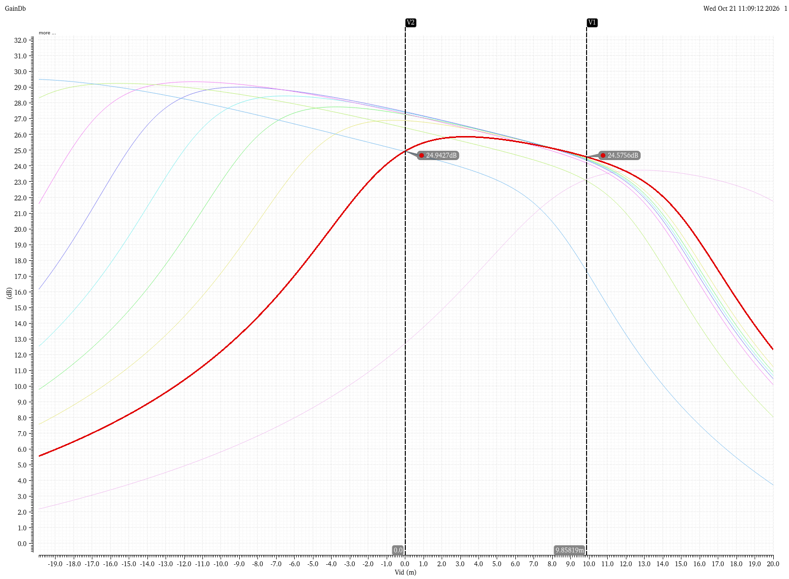
   Gain in dB vs Vid for several Vcm values. Highlighted: Vcm = 0.1 V.

| $V_{cm}$ | Gain at $V_{id}$ = 0 | dB | vs 24.4 dB |
|---|---|---|---|
| 0 | -4.327 V/V | 12.7 | fails |
| **0.1** | **-17.666 V/V** | **24.94** | **passes** |
| 0.2 | -22.087 V/V | 26.9 | passes |
| 0.3 | -23.105 V/V | 27.3 | passes |
| 0.4 | -23.447 V/V | 27.4 (reference) | passes |

$$\boxed{\text{ICMR} \approx 0.1\ \text{V to } 0.597\ \text{V}}$$

## 2.7 CMRR

How much more strongly the pair amplifies the difference than a change of the common level. For the leaf sensor, mains hum and electrode drift arrive equally on both electrodes.

$$\text{CMRR}_{dB} = A_{dm,dB} - A_{cm,dB}$$

<table>
<tr>
<td>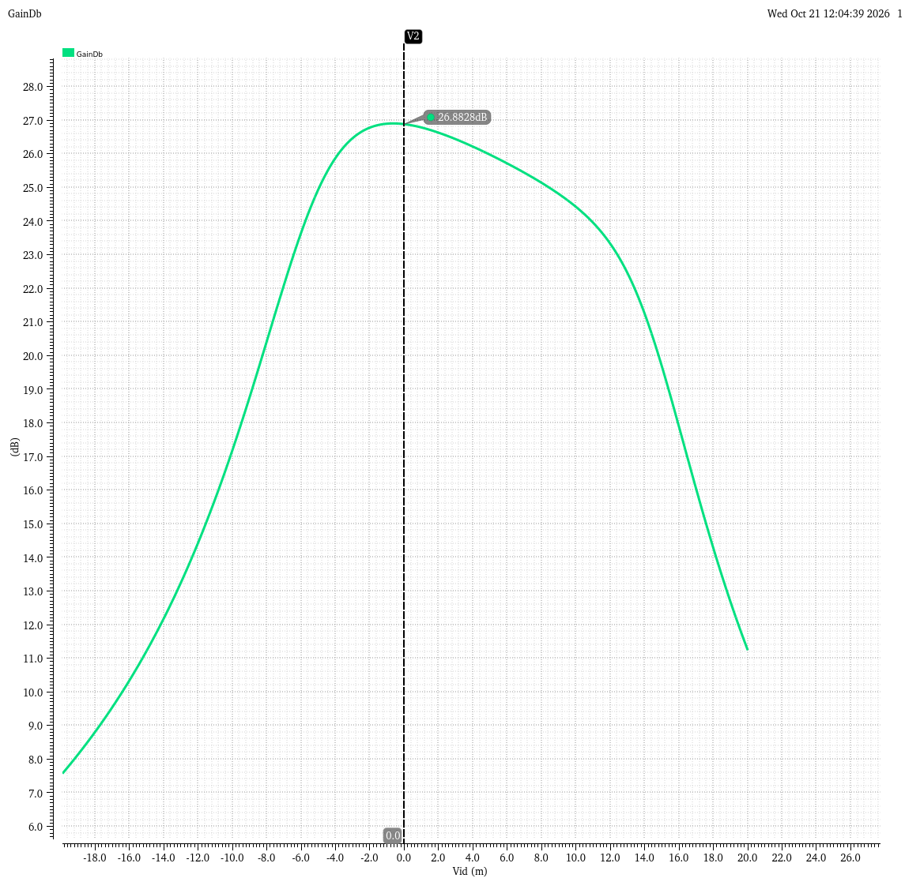</td>
<td>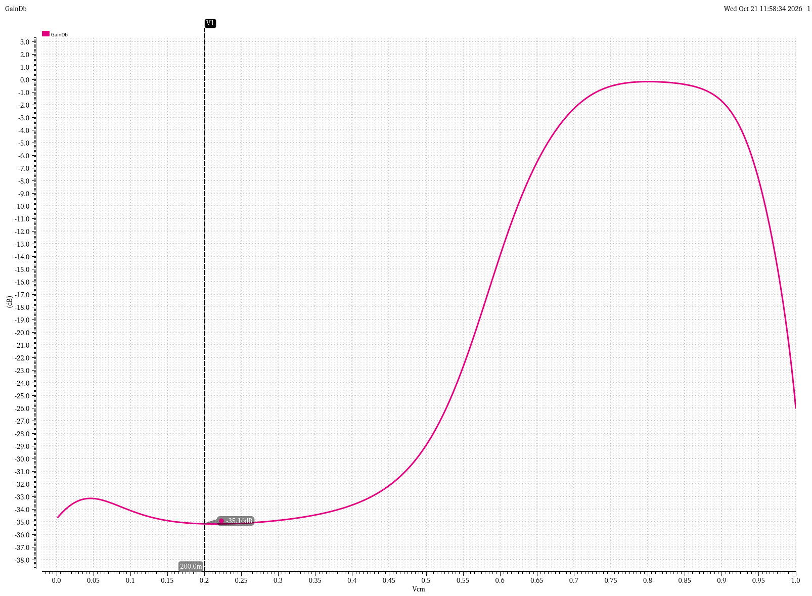</td>
</tr>
<tr>
<td align="center">Adm in dB, marker at Vid = 0 (26.88 dB)</td>
<td align="center">Acm in dB vs Vcm, marker at 0.2 V</td>
</tr>
</table>

$$\text{CMRR} = 26.88 - (-35.16) = \mathbf{62.0\ dB}$$

- $A_{cm}$ stays flat at about -35 dB from 0.1 to 0.4 V, so CMRR is about 62 dB over that range.
- Above about 0.45 V, $A_{cm}$ rises toward 0 dB: the tail current is dying (the top ICMR edge again).
- $A_{cm}$ is not zero because Q5's finite $r_o$ (452 kΩ) lets the tail current change slightly with $V_{cm}$.

CMRR versus frequency is measured on the full amplifier in [stage 4](04-full-amplifier.md#7-cmrr-vs-frequency).

---

[← 1. Current mirrors](01-current-mirrors.md) · [Overview](../README.md) · **2. Differential pair** · [3. Gain stage →](03-gain-stage.md)
