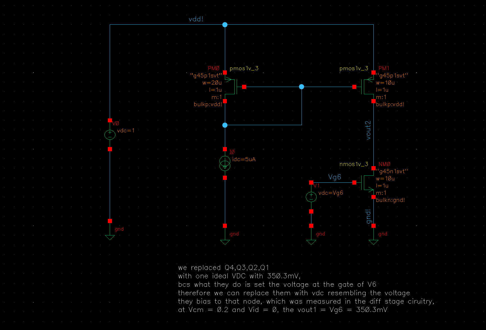
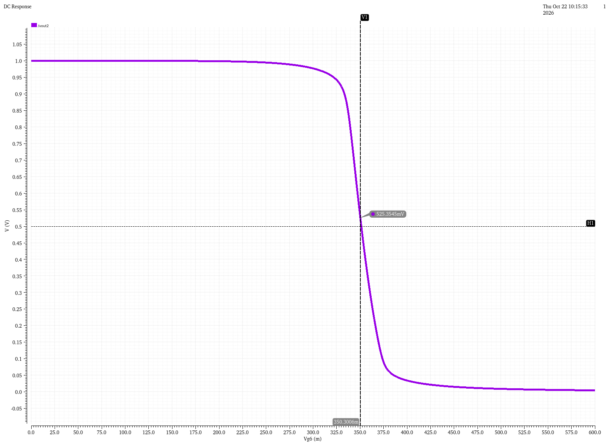
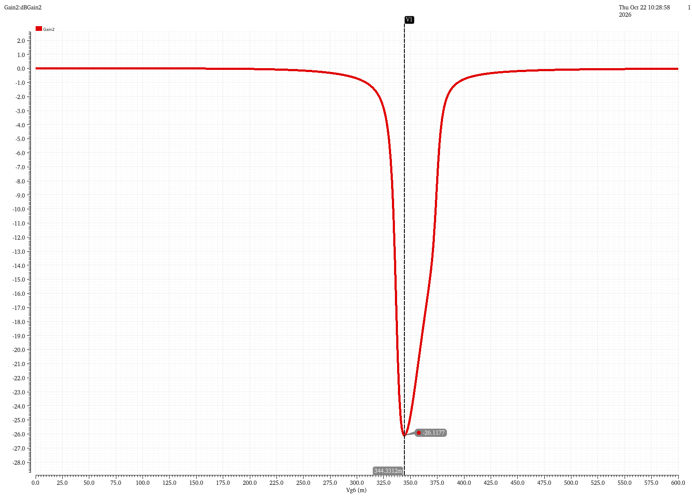
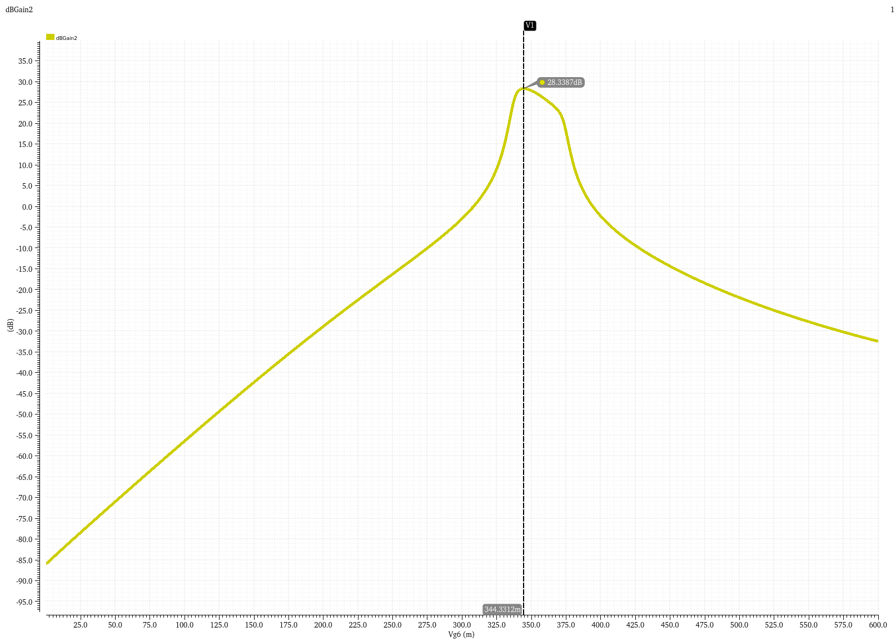
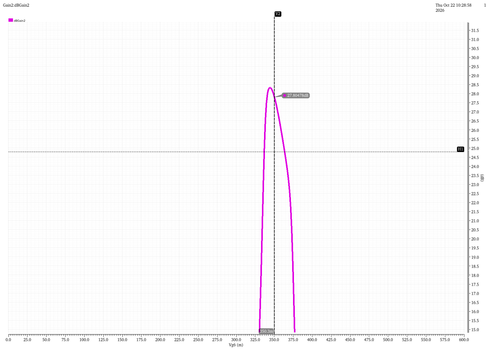
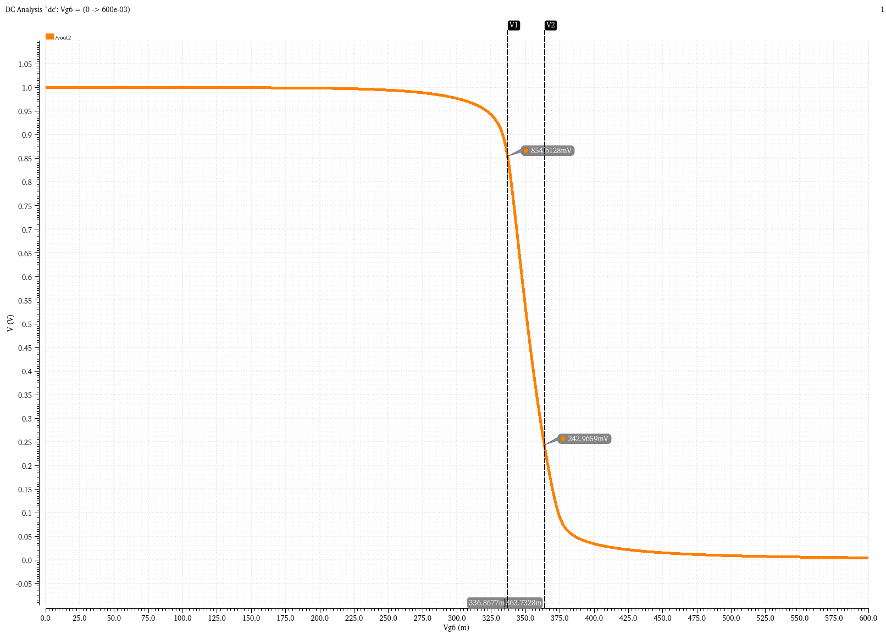

[← 2. Differential pair](02-differential-pair.md) · [Overview](../README.md) · **3. Gain stage** · [4. Full amplifier →](04-full-amplifier.md)

# 3. Gain stage

> **In one line:** an NMOS common-source transistor (Q6) with a PMOS current-source load (Q7) amplifies the first stage's output again: **-24.56 V/V (27.8 dB)**, matching the hand calculation within 0.1 %, with an output swing of **243 mV to 855 mV**.

| Result | Value |
|---|---|
| Q6 / Q7 size | 10 µm / 1 µm each |
| Operating point ($V_{g6}$ = 350.3 mV) | `vout2` = 525.4 mV, I = 2.70 µA |
| Gain, predicted / measured | -24.54 / -24.56 V/V (27.8 dB) |
| Peak gain | -26.12 V/V (28.3 dB) at $V_{g6}$ = 344.3 mV |
| Systematic offset | +1.04 mV at the gate of Q6 (about 47 µV at the amp input, *estimate*) |
| Output swing (3 dB rule) | 243 mV to 855 mV |
| Block power (bias branch + stage) | 7.70 µW |

---

## 3.1 What the block does

- **Q6** receives `out1` on its gate. A small rise of its gate makes it sink more current.
- **Q7** has its gate fixed by the bias mirror, so it pushes a **constant** current into the output and does not react to the signal.
- Q6's extra current can only come out of the output node, through $r_{o6}$ and $r_{o7}$. Current times resistance gives a large voltage swing:

$$A_2 = \frac{\Delta v_{out}}{\Delta v_{g6}} = -g_{m6}\,(r_{o6} \parallel r_{o7})$$

- **Minus sign:** gate up, Q6 pulls harder, output down. The first stage also inverts, so V+ stays non-inverting overall.
- The two stages multiply: $A_{total} = A_1 \times A_2$ (in dB they add).

**Why Q1 to Q4 are not in this testbench:** their only effect on Q6 at DC is to set its gate voltage. A gate draws no current, so an ideal source at the same value (350.3 mV, the rest value of `out1`) looks identical. This isolates the stage.

  
   Testbench: Q8 bias, Q7 load, Q6 driven by an ideal source Vg6.

## 3.2 Sizing for zero systematic offset

$$\frac{(W/L)_6}{(W/L)_4} = 2\,\frac{(W/L)_7}{(W/L)_5}$$

With Q7/Q5 = 1/2, this gives **Q6 = Q4**. In plain words: at rest `out1` equals Q4's gate voltage, set so that 2.5 µA flows. If Q6 is the same transistor at the same $V_{GS}$, it wants the same 2.5 µA, which is exactly what Q7 supplies. Nothing pushes the output up or down. Q6 and Q4 are not wired as a mirror; the match comes from the sizing.

## 3.3 Operating point

| | Q6 (NMOS CS) | Q7 (PMOS load) |
|---|---|---|
| Region (Spectre) | 3, subthreshold | 2, saturation |
| $I_D$ | 2.70365 µA | 2.70365 µA |
| $V_{GS} - V_{TH}$ | -37.76 mV | -41.19 mV (41 mV past threshold) |
| $V_{DS}$ | 525.369 mV | -474.631 mV |
| $V_{DSAT}$ | 61.18 mV | -63.28 mV |
| $g_m$ | 58.4558 µS | 68.6542 µS |
| $g_m/I_D$ | 21.62 V⁻¹ | 25.39 V⁻¹ |
| $r_o$ | 806.626 kΩ | 875.374 kΩ |
| Self gain $g_m r_o$ | 47.15 | 60.10 |

- **Q7 delivers 8.1 % too much current** (2.70 µA instead of 2.50 µA): its $V_{SD}$ is 0.475 V here, larger than in the mirror test, and finite $r_o$ adds current.
- So `vout2` rests **25.4 mV above mid-supply** (525.4 mV): the output rises until Q6's larger $V_{DS}$ lets it sink the extra current.

**Predicted gain:**

$$r_{o6} \parallel r_{o7} = \frac{1}{g_{ds6} + g_{ds7}} = \frac{1}{1.23973 + 1.14237\ \mu S} = 419.8\ k\Omega$$

$$A_2 = -58.4558\ \mu S \times 419.8\ k\Omega = -24.54\ \text{V/V}\ (27.8\ \text{dB})$$

## 3.4 Transfer curve and offset

DC sweep of $V_{g6}$ from 0 to 0.6 V, step 0.1 mV.

  
   vout2 vs Vg6. V1 at the operating point, H1 at mid-supply (500 mV).

| Marker | $V_{g6}$ | `vout2` |
|---|---|---|
| Operating point | 350.3006 mV | 525.3545 mV |
| Mid-supply | 351.3438 mV | 500.0 mV |

To bring the output to exactly 500 mV, Q6's gate must rise by **1.04 mV**. Divided by the first-stage gain (22.1), that is about **47 µV** at the amplifier input (*estimate*): negligible against a ±100 mV signal. **Q6 stays at 10 µm / 1 µm.** (The full amplifier measures an even smaller offset: [17.7 µV](04-full-amplifier.md#2-open-loop-gain-and-offset).)

## 3.5 Gain

<table>
<tr>
<td></td>
<td></td>
</tr>
<tr>
<td align="center">d(vout2)/dVg6 in V/V, marker at the peak</td>
<td align="center">Same in dB</td>
</tr>
</table>

| | Gain | dB |
|---|---|---|
| Predicted, $g_{m6}(r_{o6} \parallel r_{o7})$ | -24.54 V/V | 27.8 |
| **Measured at $V_{g6}$ = 350.3 mV** | **-24.5606 V/V** | **27.805** |
| Peak ($V_{g6}$ = 344.33 mV) | -26.1177 V/V | 28.339 |

- **Prediction and simulation agree within 0.1 %.**
- The peak sits slightly left of the operating point (higher `vout2`): with the current fixed by Q7, $r_{o6}$ grows when Q6 has more drain voltage.

Both stages give similar gain because both are one $g_m$ times two $r_o$ in parallel, with similar devices near weak inversion. There $g_m \propto I$ and $r_o \propto 1/I$, so the gain barely depends on bias current.

| Stage | Gain | dB |
|---|---|---|
| Differential pair | -22.1 V/V | 26.9 |
| Gain stage | -24.56 V/V | 27.8 |
| Product (*estimate* for the full amp) | about 543 V/V | about 54.7 |

## 3.6 Output swing

**Definition:** the range of `vout2` where the gain stays within 3 dB of its operating-point value, so above 27.8 - 3 = **24.8 dB**.

<table>
<tr>
<td></td>
<td></td>
</tr>
<tr>
<td align="center">Gain in dB with the 24.8 dB line</td>
<td align="center">vout2 at the two crossing points</td>
</tr>
</table>

| Point | $V_{g6}$ | `vout2` | Limited by |
|---|---|---|---|
| Top | 336.8677 mV | **854.6 mV** | Q7 |
| Operating point | 350.3 mV | 525.4 mV | |
| Bottom | 363.7328 mV | **243.0 mV** | Q6 |

$$\boxed{\text{Output swing} \approx 243\ \text{mV to } 855\ \text{mV}\ (\approx 612\ \text{mV p-p})}$$

Both edges come **before** the $V_{DSAT}$ limits (61 mV and 937 mV). Near weak inversion, $r_o$ falls gradually as a device loses drain voltage, well before the hard saturation limit:

| | Measured edge | $V_{DSAT}$-based limit | Voltage left across the device |
|---|---|---|---|
| Top (Q7) | 855 mV | 937 mV | 145 mV instead of 63 mV |
| Bottom (Q6) | 243 mV | 61 mV | 243 mV instead of 61 mV |

---

[← 2. Differential pair](02-differential-pair.md) · [Overview](../README.md) · **3. Gain stage** · [4. Full amplifier →](04-full-amplifier.md)
