[← 3. Gain stage](03-gain-stage.md) · [Overview](../README.md) · **4. Full amplifier** · [Cadence notes →](cadence-ade-notes.md)

# 4. Full amplifier

> **In one line:** all blocks assembled into the two-stage op-amp. It is correctly biased, draws **12.81 µW**, and after Miller compensation with a nulling resistor reaches **66.4° phase margin at 8.10 MHz**, with **62.0 dB** CMRR and **16.0 µV rms** noise over the leaf band.

| Spec | Result | Condition |
|---|---|---|
| Supply current / power | 12.81 µA / **12.81 µW** | $V_{cm}$ = 0.2 V |
| DC gain (application point) | **51.45 dB** (374 V/V) | buffer bias, $V_{cm}$ = 0.4 V |
| DC gain (open loop, mid-output) | 54.4 dB | $V_{cm}$ = 0.2 V, $V_{id}$ = 0 |
| Systematic offset | **+17.7 µV** | $V_{cm}$ = 0.2 V |
| Electrode bias | **0.4 V** | |
| GBW / phase margin | **8.10 MHz / 66.4°** | $C_c$ = 1 pF + Q9, $C_L$ = 1 pF |
| Gain / phase at 100 kHz | 38.53 dB / -77.27° | open loop |
| Buffer error at 100 kHz | 0.27 % / 0.66° | calculated |
| CMRR | **62.0 dB** at 10 Hz and 100 kHz | |
| Output swing (3 dB rule) | **250 mV to 851 mV** | $V_{cm}$ = 0.4 V |
| Input noise | 158.5 nV/√Hz at 1 kHz, 32.8 nV/√Hz at 100 kHz | buffer |
| Total noise, 100 Hz to 100 kHz | **16.0 µV rms** (SNR about 73 dB) | buffer |

---

## 1. Operating point

Single DC point at $V_{cm}$ = 0.2 V, $V_{id}$ = 0, before adding the compensation network.

  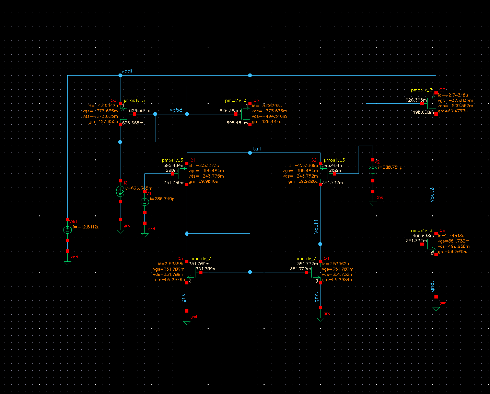
   Full amplifier, DC node voltages and operating points annotated.

| Node / device | Full amp | Single-block value |
|---|---|---|
| Bias gate `Vg58` | 626.365 mV | 626.363 mV (stage 1) |
| `tail` | 595.484 mV | |
| `Vout1` | 351.732 mV | 350.3 mV (stage 2) |
| `Vout2` | 490.638 mV | 525.4 mV (stage 3, ideal gate drive) |
| Q8 current | 4.99947 µA | 4.99968 µA |
| Q5 (tail) current | 5.06798 µA | |
| Q1 / Q2 current | 2.53373 / 2.53369 µA | balanced |
| $g_m$ Q1 / Q2 | 69.9016 / 69.9008 µS | 69.05 µS |
| **Supply current** | **12.8112 µA** | |

$$P = V_{DD} \times I_{DD} = 1.0\ \text{V} \times 12.81\ \mu A = \mathbf{12.81\ \mu W}$$

The current splits into three branches: bias 5.00 µA, tail 5.07 µA, output stage about 2.74 µA. Every block sits where the single-block tests predicted. `Vout1` is only 0.39 mV above the value that puts `Vout2` at exactly mid-supply, so `Vout2` rests at 490.6 mV.

## 2. Open-loop gain and offset

DC sweep of $V_{id}$ from -3 mV to +3 mV, step 1 µV, $V_{cm}$ = 0.2 V.

<table>
<tr>
<td>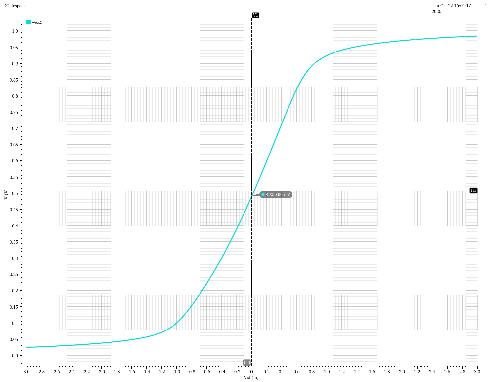</td>
<td>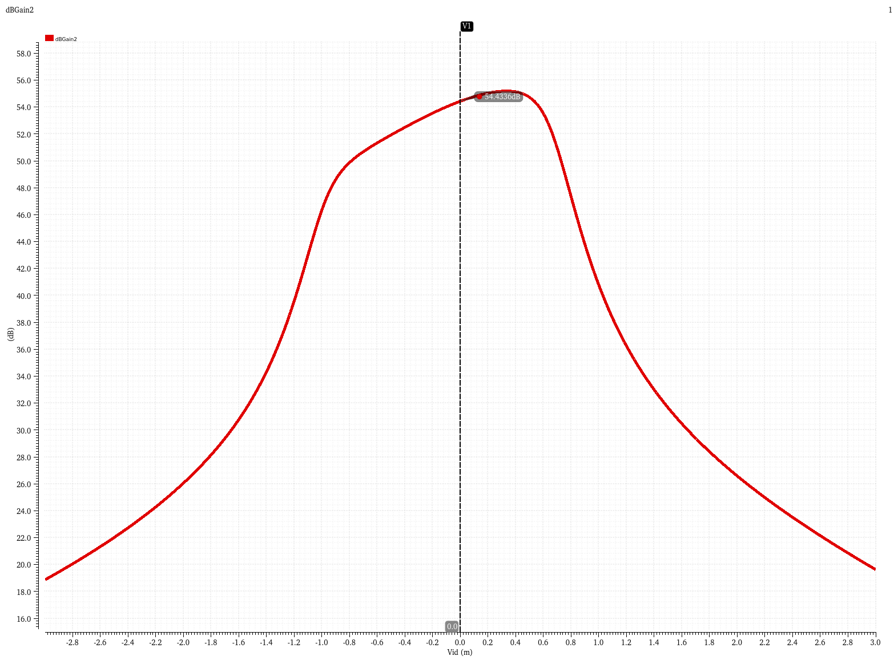</td>
</tr>
<tr>
<td align="center">Vout2 vs Vid; V1 at 0, H1 at 500 mV</td>
<td align="center">Open-loop gain in dB, marker at Vid = 0</td>
</tr>
</table>

| Item | Value |
|---|---|
| `Vout2` at $V_{id}$ = 0 | 490.6381 mV |
| **Offset** ($V_{id}$ for `Vout2` = 500 mV) | **+17.6976 µV** |
| **DC gain at $V_{id}$ = 0** | **54.4 dB** (about 525 V/V) |
| Predicted from stages 2 + 3 | 26.9 + 27.8 = 54.7 dB |

- **Gains multiply, dB add.** The measured 54.4 dB is 0.3 dB below the prediction because `Vout2` sits at 490.6 mV here instead of 525 mV, so Q6 has less drain voltage and a smaller $r_o$.
- **The offset is smaller than stage 3 alone suggested** (47 µV, *estimate*): stage 1 already puts Q6's gate within 0.39 mV of its mid-supply value, and $0.39\ \text{mV} / 22 \approx 18\ \mu V$, matching the marker.
- The whole output range is crossed by about 2 mV of input. `Vout1` stays linear over ±3 mV, so the second stage saturates first.

## 3. Buffer test and electrode bias

Q1's gate wired to `Vout2` (unity-gain buffer), input swept from 0 to 1 V. The error is `Vout2 - Vin`.

  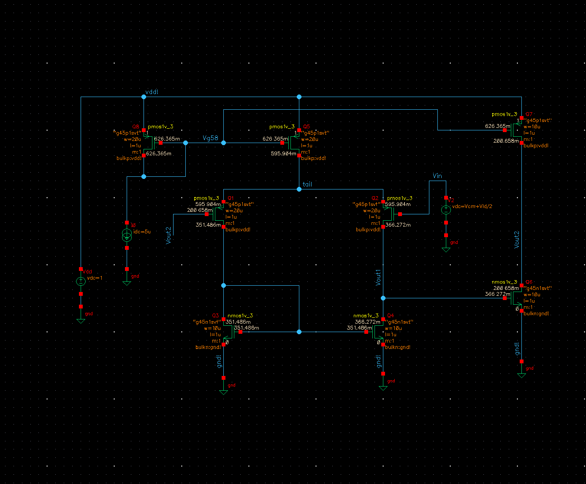
   Unity-gain buffer testbench.

<table>
<tr>
<td>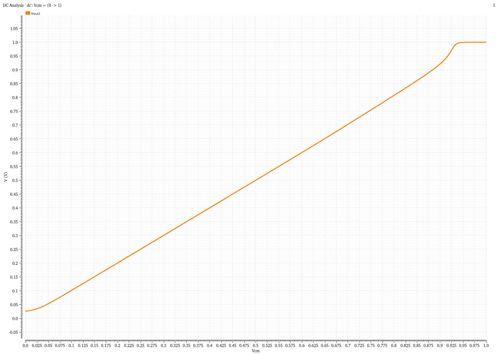</td>
<td>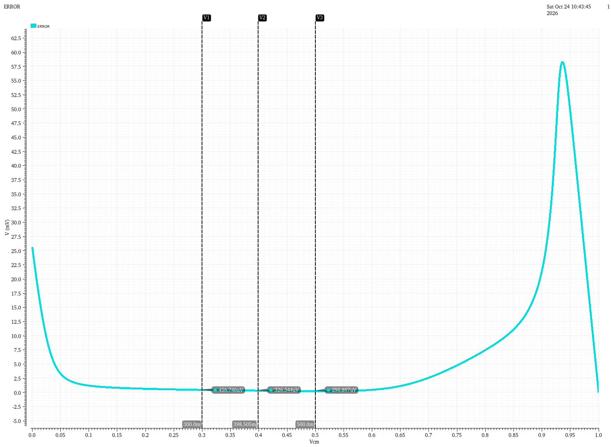</td>
</tr>
<tr>
<td align="center">Buffer output vs input</td>
<td align="center">Tracking error vs input, markers at 0.3, 0.4 and 0.5 V</td>
</tr>
</table>

| Input | Error |
|---|---|
| 0.300 V | 456.7 µV |
| 0.399 V | 326.3 µV |
| 0.500 V | 250.9 µV |

| Input range (*estimate*, from the plot) | Behaviour | Why |
|---|---|---|
| below about 0.1 V | error rises to about 25 mV | output cannot go below about 25 mV |
| **about 0.25 to 0.55 V** | **error under 0.5 mV, flat** | all transistors saturated |
| above about 0.6 V | error rises | tail source squeezed (ICMR top, 0.597 V) |

**Decision: bias the electrodes at 0.4 V.** The ±100 mV leaf signal then moves from 0.3 to 0.5 V, fully inside the accurate zone. The earlier choice of 0.2 V would have put the bottom of the signal (0.1 V) in the rising-error region.

## 4. Open-loop AC testbench

  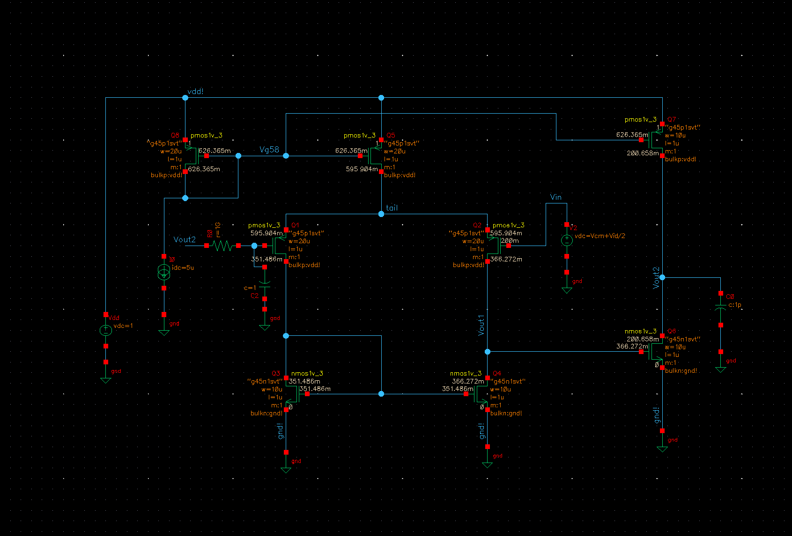
   AC testbench: Vout2 → 1 GΩ → Q1 gate, 1 F from Q1 gate to ground.

- **At DC** the 1 F capacitor is open, so Q1's gate follows `Vout2` (buffer) and the output stays centred.
- **At AC** the capacitor is a short, so Q1's gate is held still: feedback is cut and the plot shows the **open-loop** gain.
- AC magnitude 1 on the input, so `Vout2` is the gain directly. Sweep 1 Hz to 1 GHz.
- GBW is where the gain crosses 0 dB. Phase margin $PM = 180° + \text{phase at GBW}$.

## 5. What a pole is

Each high-impedance node (`Vout1`, `Vout2`) has a resistance $R$ and a capacitance $C$ to ground, which gives one pole at

$$f_p = \frac{1}{2\pi R C}$$

Above $f_p$, the node's gain falls by 20 dB per decade and its phase lags by up to 90°. Physically, the transistor current charges $C$; at high frequency each half-cycle is too short to charge it fully.

| | Gain slope after it | Phase |
|---|---|---|
| Pole | -20 dB/decade | -90° |
| Normal (left-half-plane) zero | +20 dB/decade | +90° (lead) |
| Right-half-plane zero | +20 dB/decade | **-90° (lag)** |

## 6. Frequency response and compensation

### 6.1 No compensation

<table>
<tr>
<td>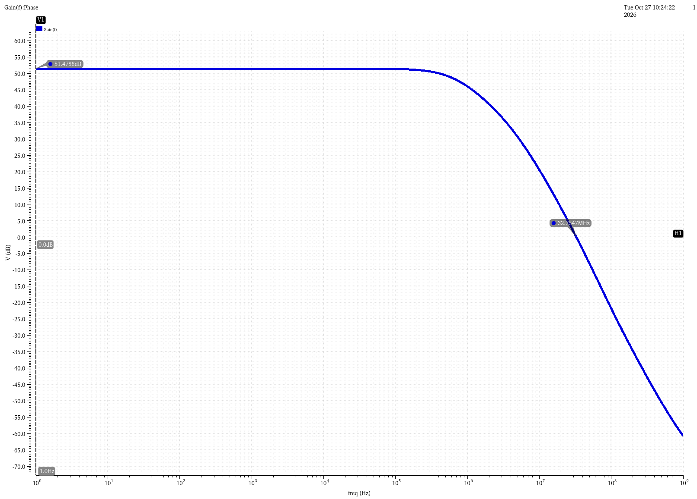</td>
<td>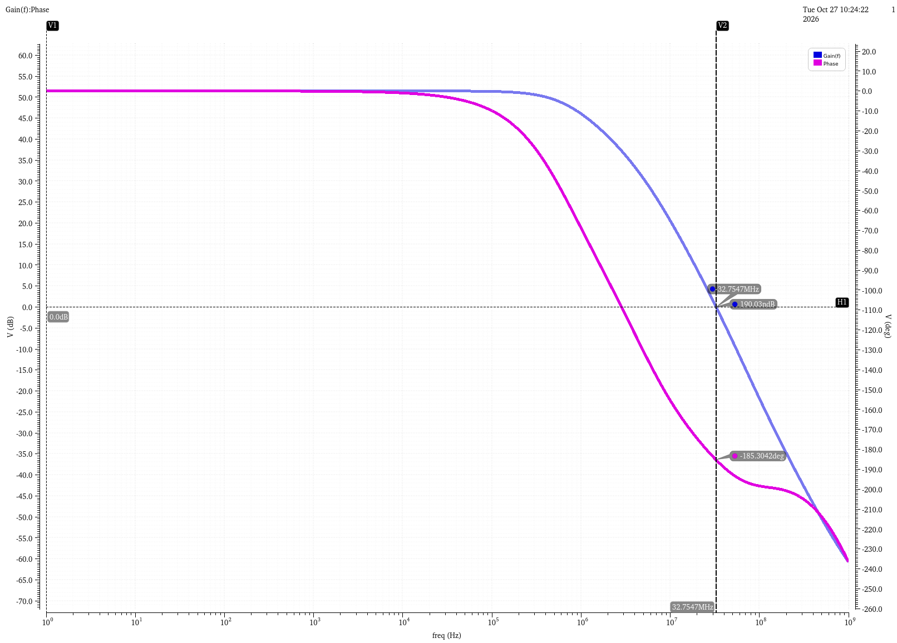</td>
</tr>
<tr>
<td align="center">Gain, no compensation</td>
<td align="center">Gain and phase, marker at the 0 dB crossing</td>
</tr>
</table>

| Item | Value |
|---|---|
| DC gain (10 Hz) | 51.48 dB |
| GBW | 32.7547 MHz |
| Phase at GBW | -185.3042° |
| **Phase margin** | **-5.3° (unstable)** |

Two poles close together each add up to 90° of lag, so the phase reaches -180° right where the gain hits 0 dB. As a buffer, this amplifier would oscillate.

### 6.2 Miller capacitor alone (1, 3, 10 pF)

<table>
<tr>
<td>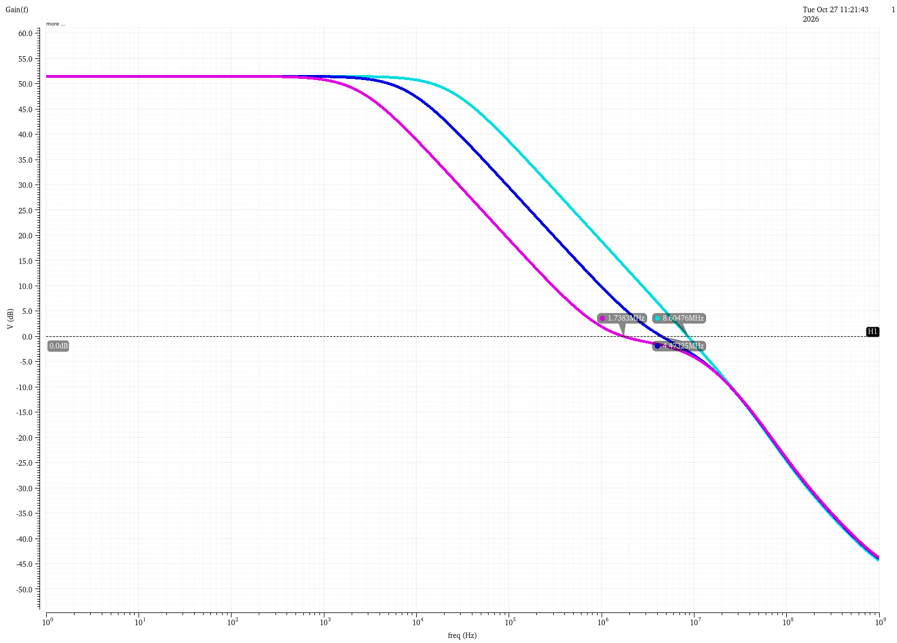</td>
<td>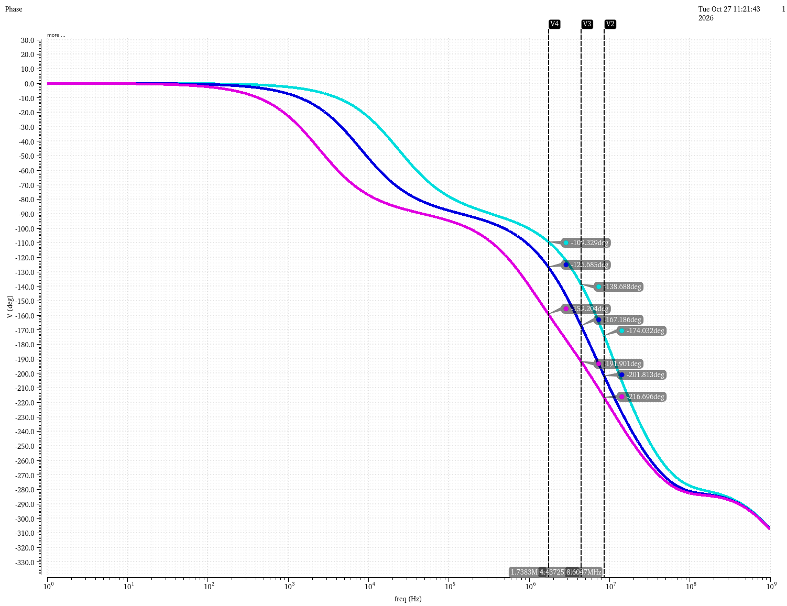</td>
</tr>
<tr>
<td align="center">Gain for Cc = 1, 3 and 10 pF</td>
<td align="center">Phase, markers at each GBW</td>
</tr>
</table>

| $C_c$ | GBW | Phase at GBW | PM |
|---|---|---|---|
| none | 32.75 MHz | -185.30° | -5.3° |
| 1 pF | 8.60 MHz | -174.03° | 6.0° |
| 3 pF | 4.47 MHz | -167.19° | 12.8° |
| 10 pF | 1.74 MHz | -159.20° | 20.8° |

**How $C_c$ helps (pole splitting):**
1. **The `Vout1` pole moves down.** The second stage has a gain of about -25: when `Vout1` moves 1 mV, `Vout2` moves 25 mV the other way, so the voltage across $C_c$ changes by 26 mV. To `Vout1`, $C_c$ looks 26 times bigger (Miller effect). Bigger C, lower pole.
2. **The `Vout2` pole moves up.** At high frequency $C_c$ ties Q6's gate to its drain, so Q6 acts like a diode: about $1/g_{m6}$ ≈ 17 kΩ instead of $r_{o6} \parallel r_{o7}$ ≈ 420 kΩ. Smaller R, higher pole.

**Why $C_c$ alone fails (right-half-plane zero):** $C_c$ gives the signal a second path from `Vout1` to `Vout2` that skips Q6. Through Q6 the signal arrives inverted; through $C_c$ it arrives not inverted. At

$$f_z = \frac{g_{m6}}{2\pi C_c}$$

the two paths cancel. Above it, the wrong-sign path wins and adds phase lag. Both $f_z$ and the GBW ($\approx g_{m1}/2\pi C_c$) scale with $1/C_c$, and $g_{m6} < g_{m1}$, so the zero always stays near or below the GBW. A bigger $C_c$ buys a few degrees and costs a lot of speed.

### 6.3 Miller capacitor + nulling resistor (final design)

Q9, an NMOS with its gate on $V_{DD}$, sits in deep triode in series with $C_c$ and carries no DC current. It behaves as a resistor $R_{on} = 1/g_{ds}$.

Target value (zero moved onto the second pole, with $C_L = C_c$):

$$R_z = \frac{1}{g_{m6}}\left(1 + \frac{C_L}{C_c}\right) \approx \frac{2}{58.5\ \mu S} \approx 34\ k\Omega \quad (\textit{estimate})$$

Anything above $1/g_{m6}$ ≈ 17 kΩ already moves the zero to the helpful side.

| Q9 (W / L) | $g_{ds}$ | $R_{on}$ |
|---|---|---|
| 2 µm / 1 µm | 119.412 µS | 8.37 kΩ (too small) |
| 10 µm / 100 nm (prototype size) | 2.06717 mS | 484 Ω (far too small) |
| **2 µm / 4 µm (final)** | **38.3667 µS** | **26.1 kΩ** |

  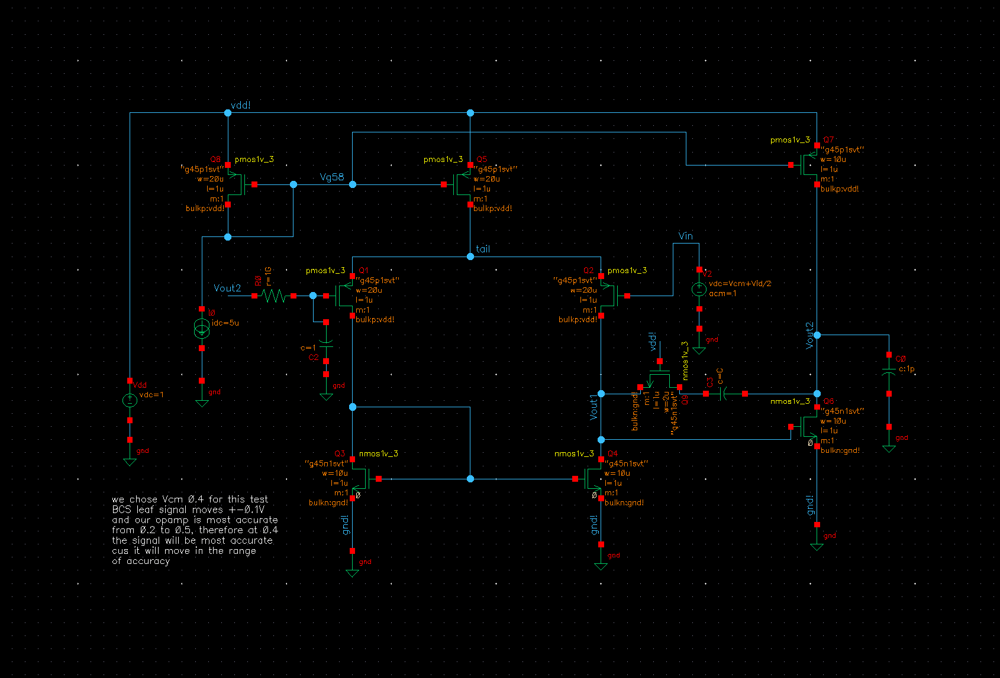
   Final compensation network: Vout1 → Q9 → Cc → Vout2.

  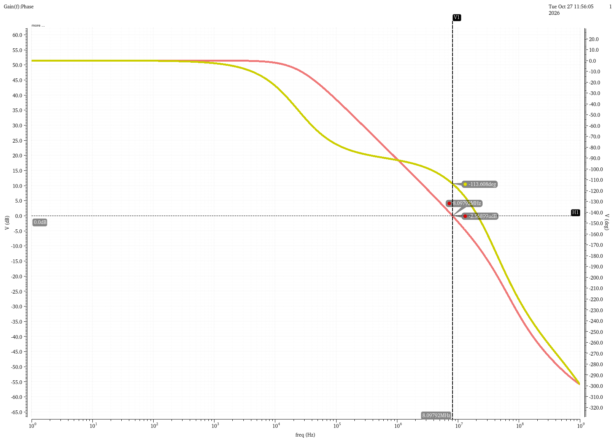
   Final open-loop gain and phase. H1 at 0 dB, V1 at the GBW.

| Item | Value |
|---|---|
| DC gain (10 Hz) | **51.45 dB** (about 374 V/V) |
| **GBW** | **8.09792 MHz** |
| Phase at GBW | -113.608° |
| **Phase margin** | **66.4°** |

<picture>
  <source media="(prefers-color-scheme: dark)" srcset="../figures/04-full-amplifier/compensation-summary-dark.png">
  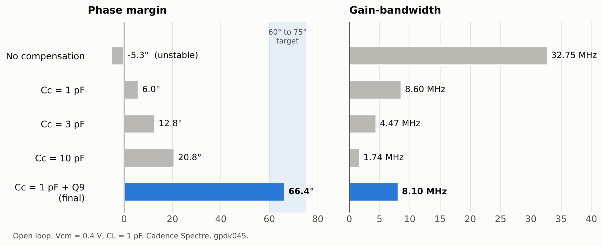
</picture>

Q9 fixes the phase almost for free: GBW drops only 6 %. 66.4° sits in the usual 60° to 75° range (small overshoot, fast settling).

### 6.4 Accuracy at the top of the leaf band

| Item | Value |
|---|---|
| Open-loop gain at 10 Hz | 51.45 dB |
| **Open-loop gain at 100 kHz** | **38.53 dB** (about 84.4 V/V) |
| **Open-loop phase at 100 kHz** | **-77.27°** |

Closed-loop buffer error, $A/(1+A)$, calculated from those two numbers:

| | Error at 100 kHz |
|---|---|
| Magnitude | **0.27 %** |
| Phase | **0.66°** |

Below 100 kHz both are smaller. The static error at DC ($1/374$ ≈ 0.27 %, *estimate*) is constant and removed by calibration. **Accuracy here is limited by GBW, not by DC gain.**

## 7. CMRR vs frequency

Same AC testbench, with the 1 F capacitor's bottom moved from ground to `Vin`. At AC both gates now get the same signal (common mode); the DC bias is unchanged.

<table>
<tr>
<td>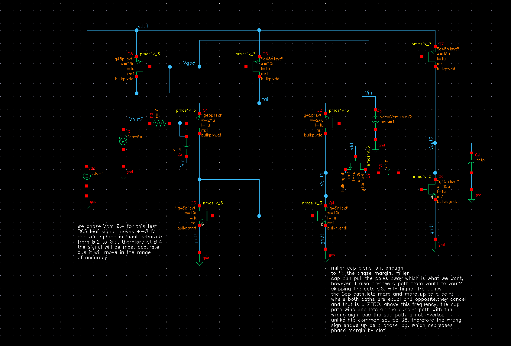</td>
<td>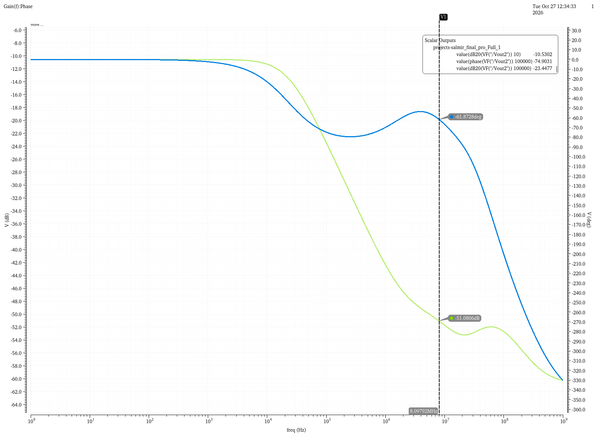</td>
</tr>
<tr>
<td align="center">CMRR testbench</td>
<td align="center">Common-mode gain and phase vs frequency</td>
</tr>
</table>

| Frequency | $A_{dm}$ | $A_{cm}$ | **CMRR** |
|---|---|---|---|
| 10 Hz | 51.45 dB | -10.53 dB | **61.98 dB** |
| 100 kHz | 38.53 dB | -23.45 dB | **61.98 dB** |

**CMRR = 62.0 dB, flat across the whole leaf band.** Both gains fall by the same 12.9 dB because both signals pass through the same compensated second stage. The value matches the input pair alone ([stage 2](02-differential-pair.md#27-cmrr)), so the pair and its tail source set it.

## 8. Output swing

Open loop again, $V_{id}$ swept from -5 mV to +5 mV at $V_{cm}$ = 0.4 V. Same 3 dB rule as stage 3.

<table>
<tr>
<td>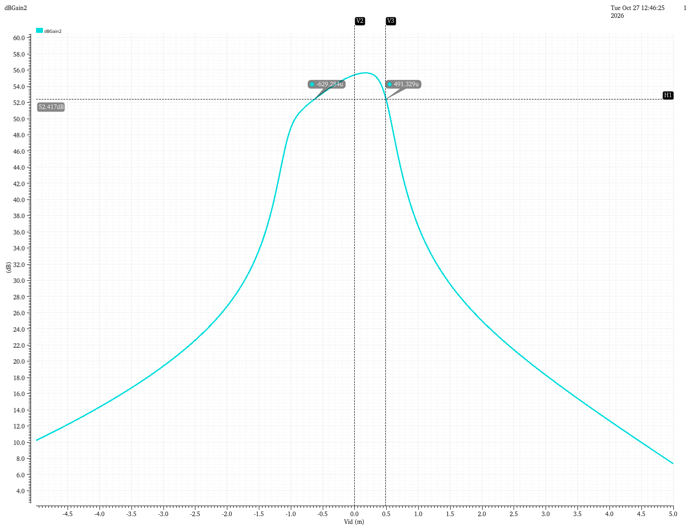</td>
<td>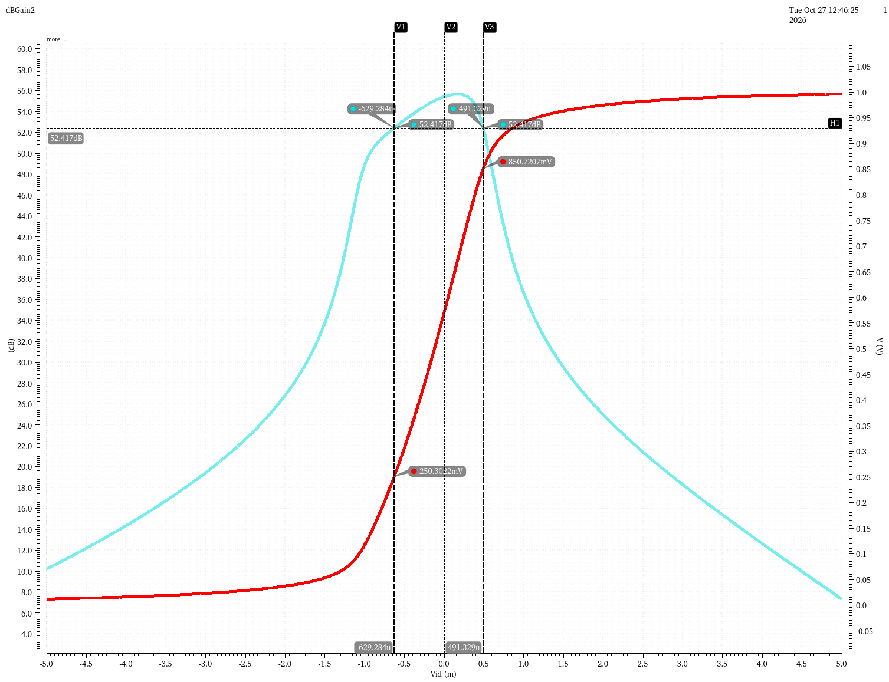</td>
</tr>
<tr>
<td align="center">Gain in dB, 3 dB line at 52.417 dB</td>
<td align="center">Gain and Vout2 vs Vid, markers at the edges</td>
</tr>
</table>

| Point | $V_{id}$ | `Vout2` |
|---|---|---|
| Gain at $V_{id}$ = 0 | 0 | 55.4171 dB (limit 52.417 dB) |
| Bottom | -629.284 µV | **250.30 mV** |
| Top | +491.329 µV | **850.72 mV** |

$$\boxed{\text{Output swing} \approx 250\ \text{mV to } 851\ \text{mV}\ (\approx 600\ \text{mV p-p})}$$

Almost identical to stage 3 alone (243 to 855 mV): the output stage sets the swing. The leaf signal at 0.4 V ± 0.1 V is fully inside.

## 9. Noise

Buffer connection, compensation and load kept. Noise analysis from 100 Hz to 100 kHz, input-referred.

  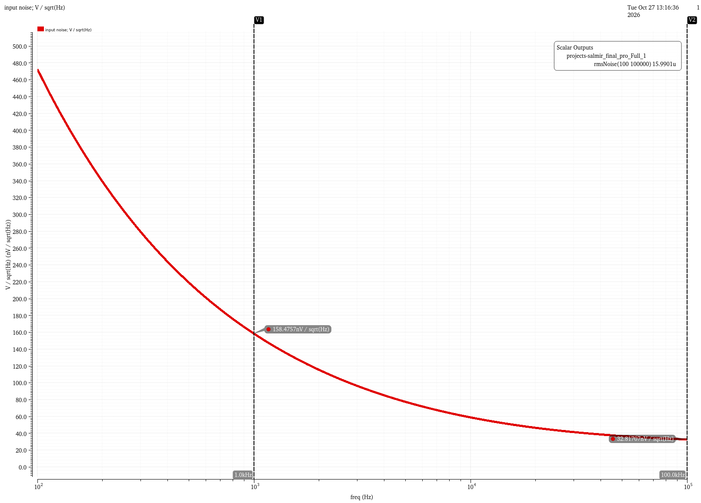
   Input-referred noise density. Markers at 1 kHz and 100 kHz.

| Item | Cadence (gpdk045, L = 1 µm) | Qucs-S prototype (PTM, L = 100 nm) |
|---|---|---|
| Input noise at 1 kHz | **158.48 nV/√Hz** | 306 nV/√Hz |
| Input noise at 100 kHz | **32.82 nV/√Hz** | 51.3 nV/√Hz |
| **Total, 100 Hz to 100 kHz** | **15.99 µV rms** | 28.4 µV rms |

- The falling part is flicker (1/f) noise; the flat floor is thermal noise.
- **About half the prototype's noise**, consistent with the much larger gate areas.
- For a ±100 mV peak signal (70.7 mV rms):

$$\text{SNR} = 20\log_{10}\frac{70.7\ \text{mV}}{16.0\ \mu V} \approx 73\ \text{dB}$$

This is a worst case: real EIS systems measure one frequency at a time with narrow filtering.

---

[← 3. Gain stage](03-gain-stage.md) · [Overview](../README.md) · **4. Full amplifier** · [Cadence notes →](cadence-ade-notes.md)
